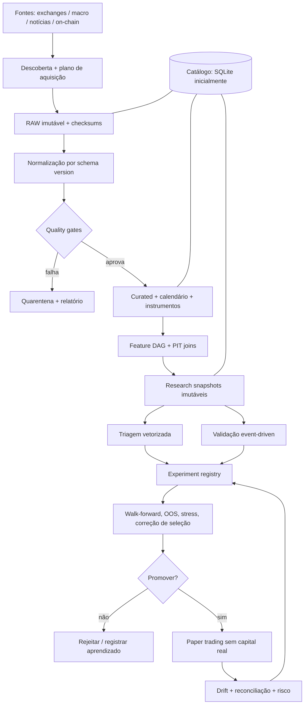
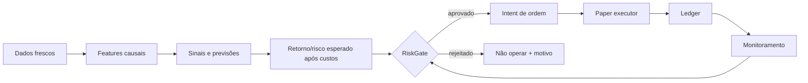
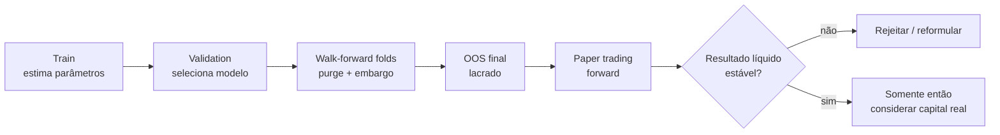
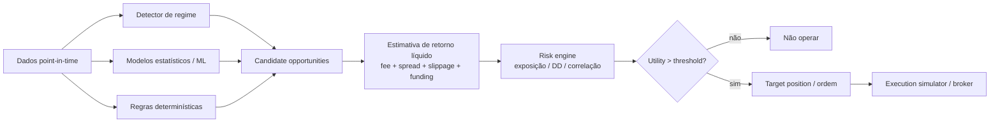
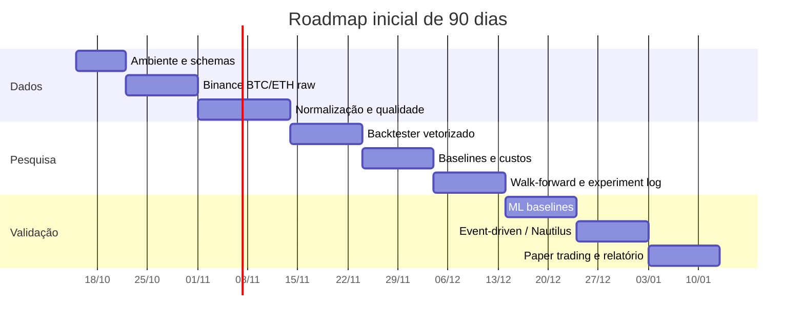

# PLANO MESTRE DE IMPLEMENTAÇÃO — LABORATÓRIO DE TRADING ALGORÍTMICO, IA E BACKTESTING CIENTÍFICO

> **Versão:** 1.0 · **Data-base:** 16/10/2026 · **Idioma:** Português (Brasil)  
> **Tipo:** Especificação técnica + plano de execução + catálogo de tarefas + protocolo de pesquisa + anexo de pesquisa aprofundada  
> **Perfil de implantação:** 1 desenvolvedor; Python; Windows com WSL2/Linux; orçamento baixo; BTC/ETH; *paper trading* antes de qualquer consideração de capital real.  
> **Filosofia:** *research first, data first, falsification first*. Todas as estratégias podem ser rejeitadas.  
> **Escopo inicial:** ferramenta privada de pesquisa, não consultoria de investimento nem recomendação de negociação.

## Como usar este documento

Este Markdown foi organizado para virar diretamente um projeto de engenharia no GitHub/GitLab. Cada épico possui dependências, tarefas verificáveis, artefatos, testes e portões de aceitação. **Não implemente todas as seções simultaneamente**: execute a trilha crítica, congele as interfaces e somente depois expanda.

**Origem do conteúdo e níveis de evidência:**

- **[R] Pesquisa anterior:** relatório técnico de investigação *Plataforma de Trading Algorítmico com IA e Backtesting Avançado*, consultado e incorporado no **Anexo A**, com catálogo e análises de dados, métodos estatísticos, stack, orçamento e experiência inaugural; material originalmente verificado em 14/10/2026. A reprodução como anexo preserva seus detalhes e eventuais limitações de verificação.
- **[V] Verificação adicional em documentação oficial:** links no capítulo Referências verificadas, consultados em 16/10/2026. Incluem Binance Public Data, OKX, FRED/ALFRED, DuckDB, SEC EDGAR, Freqtrade, vectorbt, QuantConnect LEAN e Tardis. Quando um link aponta para uma página oficial dinâmica, cobertura/preços devem ser rechecados antes de contratar/baixar em grande escala.
- **[P] Proposta de engenharia:** decisões, exemplos, políticas, métricas-alvo e estimativas deste guia. **São recomendações e critérios de projeto, não resultados de experimentos já executados.**
- **[NV] Não verificado:** licença para redistribuir dados, preços comerciais, disponibilidade histórica exata por instrumento, benchmarks de performance do nosso hardware, spreads/slippage reais. Não extrapolar.

Este arquivo é o plano, **não** é uma implementação pronta, não executou benchmarks reais do mercado e não atesta lucratividade. Os snippets são contratos e referências de implementação: precisam de testes de integração e validação de versões antes da produção.

## Índice navegável

1. [Decisões irreversíveis e escopo](#1-decisoes-irreversiveis-e-escopo)
2. [Metas, não-metas e métricas](#2-metas-nao-metas-e-metricas)
3. [Arquitetura e contratos](#3-arquitetura-e-contratos)
4. [Reaproveitamento de sistemas existentes](#4-reaproveitamento-de-sistemas-existentes)
5. [Roadmap e fluxo de dependências](#5-roadmap-e-fluxo-de-dependencias)
6. [Dados e provedores: especificação de implementação](#6-dados-e-provedores-especificacao-de-implementacao)
7. [Catálogo de dados e tempo point-in-time](#7-catalogo-de-dados-e-tempo-point-in-time)
8. [Arquitetura física do data lake](#8-arquitetura-fisica-do-data-lake)
9. [Engenharia de ingestão](#9-engenharia-de-ingestao)
10. [Garantia de qualidade](#10-garantia-de-qualidade)
11. [Feature engineering e datasets](#11-feature-engineering-e-datasets)
12. [Estratégias e baselines](#12-estrategias-e-baselines)
13. [Backtesting e execução](#13-backtesting-e-execucao)
14. [Validação científica](#14-validacao-cientifica)
15. [Machine learning e IA](#15-machine-learning-e-ia)
16. [Risco, motor de decisão e paper trading](#16-risco-motor-de-decisao-e-paper-trading)
17. [Observabilidade, segurança e operação](#17-observabilidade-seguranca-e-operacao)
18. [Estimativas de capacidade, tempo e orçamento](#18-estimativas-de-capacidade-tempo-e-orcamento)
19. [Backlog detalhado por épico](#19-backlog-detalhado-por-epico)
20. [Experimento inaugural e matriz de aprovação](#20-experimento-inaugural-e-matriz-de-aprovacao)
21. [Sequência de execução para o primeiro mês](#21-sequencia-de-execucao-para-o-primeiro-mes)
22. [Contratos de entrega, ADRs e templates](#22-contratos-de-entrega-adrs-e-templates)
23. [Referências verificadas e a verificar](#23-referencias-verificadas-e-a-verificar)
24. [Anexo A: pesquisa aprofundada anterior](#anexo-a-pesquisa-aprofundada-anterior)

---

<a id="1-decisoes-irreversiveis-e-escopo"></a>

# 1. Decisões irreversíveis e escopo

## 1.1 Enunciado do produto

Construir um **laboratório quantitativo reprodutível** capaz de converter observações de mercados em datasets corretos temporalmente, formular hipóteses, executar simulações com custos e restrições, comparar estratégias e modelos, e acompanhar *paper trading*. O projeto não deve vender a falsa premissa de que agregar mais indicadores ou usar um LLM produzirá retorno positivo.

O usuário principal inicialmente é o próprio desenvolvedor; o sistema será local-first e CLI-first. Uma UI passa a ser prioridade apenas quando os resultados tiverem rastreabilidade. O output mais importante não é um painel de lucros: é uma decisão auditável de **aprovar, rejeitar ou declarar inconclusiva** uma hipótese.

## 1.2 Contrato de escopo do MVP

**Dentro:** BTCUSDT/ETHUSDT spot; um dataset histórico canônico de 1m; consulta 15m/1h/4h/1d; proveniência por arquivo; auditoria; três famílias de estratégia; custos e portfólio simples; duas modalidades de simulação em etapas; validação walk-forward; comparação com baselines; logística/boosting opcional; rastreamento de todos os trials; protocolo de *paper trading*, sem conta real.

**Fora:** HFT, arbitragem que exige colocation, reconstrução L3 abrangente, corretagem real, multiusuário, monetização/SaaS, dados privados, modelos RL em produção, infraestrutura distribuída e promessas de retorno. Futuros perp entram assim que o núcleo spot for auditado, antes de qualquer hipótese que invoque funding, open interest ou alavancagem.

## 1.3 Regras que não podem ser violadas

1. **Nunca sobrescrever `raw`.** Fonte original, hash, endpoint, instante de captura e contrato de acesso pertencem ao registro histórico.
2. **Nunca treinar ou operar com informação que chegaria depois da decisão.** A condição básica é `max(input.available_at) <= decision_at`; veja exceções e delays nos capítulos temporais.
3. **Não alterar o conjunto OOS final para escolher parâmetros.** Se ele for consultado para decidir a próxima versão, deixa de ser holdout.
4. **Não aprovar uma estratégia pelo maior Sharpe encontrado.** Todas as tentativas devem ser registradas para avaliar seleção múltipla.
5. **Não promover modelo que não supera baselines relevantes após custos.** Uma melhora estatística sem melhora econômica pode não justificar manutenção.
6. **Não tratar retorno previsto como ordem.** Separar predição, decisão, risco, execução, contabilidade e monitoramento.
7. **Não supor fills que os dados não sustentam.** Backtest em candle não conhece a sequência intrabar; L2 não é MBO/L3; fila virtual depende de hipóteses.
8. **Nenhum segredo no Git.** Nunca colocar credenciais reais em notebooks, YAML ou relatórios.
9. **Modo offline/paper como estado padrão e tecnicamente restrito.** Sem rota de envio a exchange real na v1.
10. **Idempotência, observabilidade e falha fechada.** Perder conexão, timestamp ou controle de qualidade deve impedir novos sinais executáveis.

## 1.4 Sucesso significa o quê?

**Engenharia bem-sucedida:** datasets rastreáveis, resultados reexecutáveis, testes automatizados, execução em ambiente isolado, relatórios e simulação consistente. **Pesquisa bem-sucedida:** detectar hipóteses falsas, estimar incerteza e recusar estratégias sem evidência. **Trading bem-sucedido:** somente poderia ser avaliado depois de observações forward e restrições reais, fora da definição de pronto do MVP.

---

<a id="2-metas-nao-metas-e-metricas"></a>

# 2. Metas, não-metas e métricas

| Dimensão | Meta de engenharia (proposta, não resultado) | Como medir |
|---|---|---|
| Reprodutibilidade | 100% dos experimentos com Git SHA, config hash e dataset IDs | Auditoria `reproduce --id EXP` |
| Integridade | 100% dos objetos raw possuem SHA-256 e status | Query ao catálogo |
| Temporalidade | 0 violações de PIT nos testes automatizados | `pytest tests/leakage` |
| Cobertura | Relatório explícito para cada mês/ativo/timeframe | `audit coverage` |
| Correção de ledger | Invariantes de caixa, posições, taxas, equity e P&L validados | Testes unitários e golden tests |
| Eficiência | Coleta 1 mês de um símbolo com uso de memória limitado | Profiling local |
| Robustez | Toda candidata possui grade de custos, subperíodos e walk-forward | Artefatos EXP |
| Maturidade | Replay do mesmo dataset gera os mesmos resultados salvo nondeterminismo registrado | Hash de artefatos canônicos |
| Segurança | V1 não consegue emitir ordem real | Teste negativo de integração |

**SLOs somente após medição:** atualizar dados diários dentro de janela definida por venue, detectar falha de atualização, produzir relatórios sem intervenção e manter disponibilidade do simulador quando a internet oscilar. Não inventar números de latência nem garantias de uptime antes de medir no computador real.

### Perguntas estratégicas que o sistema deverá responder

- Existe edge líquido fora da amostra ou o sinal é explicável por exposição direcional, sorte, múltiplos testes ou custos ignorados?
- Quais hipóteses sobrevivem a 2×–3× custos, mudança de ativo, período e exchange?
- Funding, flow, macro e notícias agregam poder preditivo mensurável sobre preço/volume?
- O modelo piorou ou mudou a distribuição do mercado? Qual é a incerteza dessa conclusão?
- Em quais condições a estratégia deveria ficar em caixa e por quê?

---

<a id="3-arquitetura-e-contratos"></a>

# 3. Arquitetura e contratos

## 3.1 Desenho lógico



O ledger de experimentos e o catálogo de dados são conceitos distintos. O primeiro registra hipóteses/execuções; o segundo, objetos/versionamentos. Ambos podem começar em SQLite ou arquivos transacionais leves, enquanto dados analíticos de grande volume continuam em Parquet.

## 3.2 Fluxo do domínio financeiro

```text
MarketData/Features -> Prediction/Signal -> TargetPosition
    -> RiskApproval -> OrderIntent -> ExecutionAdapter
    -> OrderEvent/FillEvent -> PositionLedger/CashLedger
    -> Mark-to-Market -> PortfolioMetrics -> ExperimentReport
```

**Nunca compartilhar semântica de ordem, trade e posição:** intenção não é ordem enviada; ordem aceita não é fill; fill não é P&L fechado; trade não implica que a carteira esteve sem exposição intrabar.

## 3.3 Contratos internos sugeridos

- `DataSource.discover(context) -> Iterable[RemoteObject]`: retorna itens históricos disponíveis sem baixar.
- `DataSource.fetch(object, destination) -> FetchReceipt`: executa transferência atômica com metadados HTTP.
- `Normalizer.convert(raw_object, schema) -> Partition`: normaliza sem perder raw.
- `QualityGate.validate(partition) -> QualityReport`: rejeita ou aprova explicitamente.
- `FeaturePipeline.compute(snapshot, cutoff) -> FeatureSnapshot`: calcula apenas com informação elegível.
- `Strategy.on_observation(context) -> TargetPosition`: não emite ordens diretamente.
- `RiskEngine.authorize(target, portfolio, market_state) -> Decision`: preserva justificativa.
- `ExecutionAdapter.simulate/order -> Events`: implementação troca vetor/event-driven/paper, mas sem confundir capacidades.
- `ExperimentRunner.run(config, snapshots) -> ImmutableRun`: grava todos os parâmetros e tentativas.

## 3.4 Arquitetura física na máquina individual

**Windows 10/11 + WSL2 (Ubuntu) ou Linux nativo**, com código e data lake no sistema de arquivos Linux quando possível. Evitar ficar consultando milhões de arquivos pequenos em drive Windows montado em `/mnt/c`, o que pode atrapalhar I/O em ambientes WSL. Um SSD para dados operacionais + backup separado é mais útil no início do que GPU potente.

Não montar Kafka/Kubernetes/Spark por antecipação. O fluxo inicial é batch; Python+HTTPX para ingestão, Polars/PyArrow para conversão, DuckDB para consultas, `pytest` para testes, scripts locais para agendamento e Git/lockfile para código. O estado de experimentos pode migrar para MLflow quando necessário.

## 3.5 Registro de decisões arquiteturais (ADR)

Criar `docs/adr/0001-architecture.md` e registrar: problema, contexto, opções avaliadas, critérios, decisão, trade-offs, riscos e condição de revisão. ADRs prioritárias:

- ADR-001: data lake próprio versus base gerenciada.
- ADR-002: Parquet como formato canônico.
- ADR-003: engine vetorizada vs. validação event-driven.
- ADR-004: Freqtrade como acelerador e NautilusTrader como candidato principal para fidelidade de execução.
- ADR-005: dados PIT e política de revisões.
- ADR-006: ledger próprio vs. relatórios nativos de cada backtester.
- ADR-007: critérios de congelamento de holdout.
- ADR-008: restrição explícita a paper trading.

---

<a id="4-reaproveitamento-de-sistemas-existentes"></a>

# 4. Reaproveitamento de sistemas existentes

**Aprender com sistemas maduros é obrigatório, mas importar toda uma plataforma pode criar lock-in.** A integração será por portas/adaptadores e experimentos de equivalência.

| Tecnologia | Usar para | Aprender estudando | Limitação | Decisão atual |
|---|---|---|---|---|
| Freqtrade/FreqAI | Baselines candle-based, lookahead-analysis, dry-run, referências de ML | Backtest, estratégia, fee, export de trades, FreqAI | Generalização L2/L3 e microestrutura limitada | Laboratório opcional e validador paralelo, não modelo canônico |
| vectorbt | Grid de parâmetros e protótipos vetorizados | Simulações de portfólio, drawdown, custos, filtros de sinais | Não reconstitui fila/impacto real; Apache 2.0 **com Commons Clause**, observar restrições de venda | Adotar somente com avaliação de licença |
| NautilusTrader | Backtest de eventos, fills, livro e futuro paper/live | Barras/ticks/books, catálogo, matching, configurações de venue | Curva de aprendizado e integração mais complexas | Candidato principal para validação de microestrutura |
| QuantConnect LEAN | Arquitetura de engine/portfolio/corporate actions e benchmark de decisões | Separação DataFeed/Algo/Transactions/Realtime/Result | Core C#, integração multiasset; CLI para backtests locais pode exigir plano pago | Referência e prova de conceito, não dependência principal |
| Microsoft Qlib | Pipeline de features, treino, inferência e organização de experimentos | Data Handler/Loader/Dataset, Workflow e Forecast Model | Mais voltado a pesquisa sistemática do que a L2/crypto replay | Referência de arquitetura de ML |
| Hummingbot | Conectores CEX/DEX e eventual market making | Estado da venue, exchange connectors, riscos de live | Não resolve validação científica de pesquisa | Adiar |
| Backtrader/Zipline | Eventos, ordem, corporate actions, histórico de padrões | Design de feed/cerebro/broker | Compatibilidade e maturidade precisam auditoria pontual | Estudo conceitual, sem dependência inicial |
| FinRL/TensorTrade | Ambientes de RL | Ambientes, reward e experimentos | Sim-to-real e reward hacking | Pesquisa distante |
| DuckDB + Polars | Operação local do lake | Pushdown, lazy execution, row groups, joins PIT | Não substituem mensageria/fonte live | Adotar de início |

**Prova de substituibilidade:** a mesma estratégia-base, alimentada pelo mesmo arquivo curado, com sinais no mesmo timestamp e mesmas hipóteses de fill, deverá gerar diferenças explicadas entre motores. Contratos distintos entre Freqtrade e Nautilus não devem ser disfarçados sob uma API falsa de comportamento idêntico.

**Licenças:** separar licença do software de licença do *conteúdo dos feeds*. O repositório público do download da Binance não concede automaticamente direito irrestrito de redistribuir dados comerciais; conferir termos de cada origem. Antes de qualquer SaaS comercial, revisar GPLv3 (Freqtrade), Commons Clause (vectorbt), LGPL do Nautilus e provedores de dados com assessoria apropriada.

**Projeto-exercício de leitura de código:** reproduzir um backtest oficial de Freqtrade e registrar (a) intervalo de sinais, (b) quando há ordem, (c) mecanismo de fill, (d) taxas, (e) equity e (f) relatórios; repetir com Nautilus em dataset mínimo. Só depois criar os próprios adapters.

---

<a id="5-roadmap-e-fluxo-de-dependencias"></a>

# 5. Roadmap e fluxo de dependências

| Onda | Semanas-alvo | Entrega | Dependência bloqueante |
|---|---|---|---|
| W0 — Fundação | 1–2 | CI, ambiente, contratos, experimento mínimo em framework existente | Nenhuma |
| W1 — Dados brutos | 2–4 | Downloader Binance mensal/diário + hash + catálogo | W0 |
| W2 — Lake auditável | 3–6 | Normalização 1m, agregação, quarentena, PIT, snapshots | W1 |
| W3 — Baselines | 5–8 | Buy & hold/cash/trend/breakout/reversion; custos e relatórios | W2 |
| W4 — Event-driven | 7–11 | Nautilus PoC + equivalência de ordens/ledger | W3 |
| W5 — Estatística | 8–12 | Walk-forward, holdout, bootstrap, testes de leakage | W3; recomendado W4 |
| W6 — ML inicial | 10–15 | Lineares, boosting, tracking, calibração, ablation | W5 |
| W7 — Paper mode | 13–18 | Simulação contínua, logs, kill switches, reconciliação | W4–W6 |
| W8 — Dados incrementais | 15+ | Funding, perpetuais, OKX, ALFRED | W2 + hipóteses |
| W9 — Pesquisa avançada | Depois | Microestrutura, on-chain, notícias, ações, opções | Resultados de ablation, tempo e orçamento |

**90 dias correspondem a uma meta agressiva de MVP**, não à conclusão de validação forward. Não comprimir qualidade estatística para encaixar ML e paper trading no calendário. Uma implementação individual séria pode precisar de 4–6 meses para chegar ao início do paper mode, conforme ritmo, hardware e familiaridade.

### Portões de passagem

- **G0 / ambiente:** `pytest` e lint executados com versões fixadas.
- **G1 / ingestão:** byte original e manifest verificáveis; falhas retomáveis.
- **G2 / dataset:** UTC, símbolo, cobertura e coerência de OHLC validados; gaps explícitos.
- **G3 / backtest:** P&L e ordem de eventos demonstrados com casos de teste artificiais.
- **G4 / ciência:** holdout protegido; trials completos; relatório de custos e robustez.
- **G5 / ML:** ganho incremental (quando houver) avaliado OOS, com calibração e comparação.
- **G6 / paper:** fluxos idempotentes, nenhuma rota live, riscos e estado reconciliados.

A promoção não é automática por idade do projeto: cada G depende de **evidências/artefatos**, não de checkboxes sem testes.

---


<a id="6-dados-e-provedores-especificacao-de-implementacao"></a>

# 6. Dados e provedores: especificação de implementação

## 6.1 Política de seleção de dados

Não confundir **quantidade de fontes** com poder preditivo. Cada novo feed deverá trazer: hipótese específica, janela histórica utilizável, granularidade, point-in-time, custo total, direitos de armazenamento, testes de qualidade e plano de ablation. O primeiro item obrigatório é o registro da **possibilidade efetiva de compra/acesso**, não apenas a existência de endpoint publicitário.

### Matriz operacional de aquisição

| Fonte | Categoria e papel | Disponibilidade/cautela | Ação de implementação | Prioridade |
|---|---|---|---|---|
| Binance Public Data | SPOT e USD-M/COIN-M conforme arquivos; klines, trades e aggTrades | Arquivos diários/mensais; spot desde 2025 usa timestamps em microssegundos | Implementar downloader, checksum, normalizador e reconciliador | P0 |
| Binance Futures API | Funding, mark, index, OI e contrato | OI histórico por endpoint pode ter retenção curta; não supor backfill profundo | Registrar política de retenção por endpoint; coleta incremental | P1 |
| OKX Historical Data | Tick trades, candles, funding, L2 | Website anuncia datas iniciais por categoria, cobertura por símbolo varia | PoC downloader, reconciliação e venue cross-check | P1 |
| Bybit | Spot/perp/trades e arquivos | Histórico/licença por produto precisam validação | Conector condicionado a revisão de termos | P2 |
| Kraken | Spot, futures, API e dados pontuais | Histórico profundo não presumido de API paginada | Adaptador de query e protocolo de gap | P2 |
| Tardis.dev | Trades, quotes, L2, liquidações, funding, options | Fonte comercial granular; amostras e planos por licença | PoC de um dia/mês **quando houver tese** | P2/P3 |
| Coinbase | Segunda venue spot e eventual execução | Não presumir arquivo bulk longo | Catalogar endpoint, limitação e cobertura real | P2 |
| Deribit | Opções BTC/ETH | Sem histórico completo de book/tick gratuitamente validado | Avaliar dados/termos antes de opções | P3 |
| CoinGecko/CMC | Metadados e agregados | Plano/direitos variáveis; não fonte canônica de trades | Snapshot de ativo, mapeamento e universo | P2 |
| CoinAPI/Kaiko/Amberdata | Normalização e datasets profissionais | Preço e licença sob contrato; não custo zero | Cotar recorte após identificar problema | P3 |
| Glassnode/CryptoQuant | Indicadores derivados on-chain | Metodologia, mudanças de endereço e retenção por plano | Snapshot PIT + metodologias e ensaio incremental | P3 |
| Dune/The Graph | Blockchain indexada e consultas | Resultado de consulta pode ser recalculado retroativamente | Congelar query, bloco, código e data de execução | P3 |
| DefiLlama | TVL/DeFi | Cobertura e política de endpoints podem mudar | Cache, observação, mudança de metodologia | P3 |
| FRED/ALFRED | Macroeconomia com vintages | API key; direitos de séries subjacentes diferem | Normalizar vintage/publish-time | P1 |
| BCB/SGS | Séries brasileiras | Identificar unidade, periodicidade e revisões | Conector por `series_id`, snapshot e disponibilidade | P1/P2 |
| B3/CVM | Cotações, ações e fundamentos Brasil | Nem todo produto da B3 é grátis; preço ajustado/PIT separados | Incluir na fase ações e construir universo de delistados | P3 |
| SEC EDGAR | Filings EUA e XBRL | Acesso público com política de uso justo e identificação no User-Agent | Coleta PIT de filings apenas quando ações EUA entrarem | P3 |
| Massive/Databento/Nasdaq Data Link | Equities, futuros e schema histórico | Assinaturas e licença específicas; verificar por dataset | Benchmark de um recorte pequeno e cotação | P3 |
| GDELT, notícias, Reddit, Google Trends | Texto/sentimento/eventos | Histórico atualizado retroativamente, políticas e viés de amostragem | Ingestão temporal separada com publicação original | P3 |
| CCXT | Interface de APIs de exchanges, **não provedor histórico independente** | Capacidade real depende da exchange | Conector auxiliar, jamais substituir proveniência | Auxiliar |

A pesquisa anterior (Anexo A) traz a **matriz mais longa**, com granularidade, datas de início, preços observados e lacunas explicitamente não verificadas. Consultar esse anexo antes de qualquer contrato ou entrada de fonte nova; atualizar preço na data da compra em vez de repetir cotações de 14/10/2026.

## 6.2 Como auditar um provedor antes de adotar

Preencher um formulário YAML e manter histórico de mudanças:

```yaml
provider: binance_public_data
verified_at: '2026-10-16'
official_docs: 'https://github.com/binance/binance-public-data'
transport: ['https', 'zip', 'csv']
asset_classes: ['crypto_spot', 'crypto_derivatives']
datasets: ['klines', 'trades', 'aggTrades']
historical_start: 'VARIES_BY_MARKET_AND_SYMBOL'
historical_end: 'CURRENT_ARCHIVE_WINDOW'
resolution: ['1m', 'trades']
license_to_store: 'RECHECK_TERMS'
license_to_redistribute: 'UNVERIFIED'
rate_limits: 'DOCUMENT_PER_ENDPOINT'
precision_rules:
  - 'spot pre-2025 timestamp milliseconds'
  - 'spot from 2025-01-01 timestamp microseconds'
provenance_required: ['url', 'sha256', 'downloaded_at', 'parser_version']
owner: 'data-engineering'
status: 'candidate_for_mvp'
```

**Checklist de diligência:** (1) documentação oficial, (2) exemplos de resposta reais, (3) histórico disponível por símbolo, (4) janela máxima da API, (5) paginação, (6) rate limit, (7) checksum, (8) política de revisões, (9) direitos de retenção e uso comercial, (10) preço total em BRL, (11) limites de requisições, (12) estabilidade de campos, (13) status do instrumento quando deslistado, (14) deduplicação, (15) timezone, (16) demora de publicação, (17) termos de uso, (18) plano de saída se a fonte for encerrada.

## 6.3 Estratégia de aquisição por classe

**A. Candles e trades:** baixar arquivos mensais em paralelo limitado, validar checksum oficial, registrar headers e schema, converter precisão temporal, ordenar por tempo/ID, nunca perder a versão original. Arquivos diários completam o mês atual. Quando o arquivo mensal chegar, reconciliar os diários; não substituir sem relatório de diferenças.

**B. Perpétuos:** separar trade price, mark price, index price, funding efetivamente realizado e funding previsto. Posição perp exige regra de liquidação, margem, taxa e *cashflows* de funding. Não retroceder um valor de open interest publicado agora para antes do horário em que ficou disponível. Capturar incrementalmente endpoints de retenção curta desde o primeiro dia para acumular histórico próprio.

**C. Microestrutura:** implementar L1/quotes antes de L2, e L2 antes de L3; usar snapshots + updates sequenciais para book; invalidar períodos de gap; guardar versões nativas da venue; comparar com trades e spreads. Para teste de sinal sem fills complexos, quotes L1 podem ser investimento melhor que L3 amplo.

**D. Macro:** consultar ALFRED em vintage adequada, preservar `observation_period`, `release_at`, `vintage_start/end`, `received_at`. Datas de observação econômica não equivalem a data de publicação. Alinhamento por `asof` causal.

**E. Documentos/notícias:** salvar manchete/texto tal como capturado, URL, ID, hash, horário de primeira publicação, horário de edição e observação, e idioma. Conteúdo que foi corrigido meses depois deve ser uma **nova versão**; não substituir conteúdo disponível na época.

**F. Ações e ETFs:** antes de alpha cross-sectional é obrigatório histórico de empresas mortas/deslistadas e universo elegível em cada data. Também distinguir preços ajustados e não ajustados, dividendos/splits e data de anúncio/ex-date; usar calendário de negociação. Ao contrário de cripto, sessão e feriado são parte do domínio.

---

<a id="7-catalogo-de-dados-e-tempo-point-in-time"></a>

# 7. Catálogo de dados e tempo point-in-time

## 7.1 Identidade de instrumento

Um símbolo não identifica um ativo de maneira global. `BTCUSDT` spot na Binance não é perp; outro venue pode usar `BTC-USDT` com convenções diferentes. Emitir `instrument_id` imutável, com `venue`, `market_type`, `base`, `quote`, `settlement`, `contract_multiplier`, `tick_size`, `lot_size`, `min_notional`, períodos válidos e identificador nativo.

**Tabela `instruments`:**

```text
instrument_id          STRING (chave estável interna)
venue                  STRING
native_symbol          STRING
market_type            ENUM spot|linear_perp|inverse_perp|future|option|equity|etf
base_currency          STRING
quote_currency         STRING
settlement_currency    STRING nullable
contract_multiplier    DECIMAL nullable
tick_size              DECIMAL
lot_step               DECIMAL
min_qty                DECIMAL
min_notional           DECIMAL nullable
valid_from             TIMESTAMP UTC
valid_to               TIMESTAMP UTC nullable
spec_published_at      TIMESTAMP UTC nullable
source_manifest_id      STRING
```

A lógica de negociações usa especificações vigentes no **instante da ordem**, não as especificações atuais. Mudanças de tick size e lot step podem tornar inválida uma ordem histórica se aplicadas retroativamente.

## 7.2 Modelo temporal explícito

- `event_at`: momento do fenômeno (trade, snapshot, release, atualização).
- `interval_start/end`: necessário para candles e observações agregadas.
- `published_at`: momento em que a fonte publicou a informação ou valor, se documentado.
- `received_at`: instante UTC em que nosso coletor recebeu a informação; em backfill histórico é a hora em que *nós baixamos*, não o tempo histórico de disponibilidade.
- `available_at`: primeiro instante defensável em que um trader histórico poderia acessar o registro; pode exigir publicação + atraso conservador; marcar `availability_confidence` como exata, estimada ou desconhecida.
- `revision_id`: versão da observação e intervalo de vigência.
- `recorded_at`: quando foi incluída na nossa base.

**Ponto sutil:** para arquivos baixados anos depois, `received_at` não demonstra que o valor era conhecido anos antes. A hora histórica precisa vir do mercado/provedor e das garantias de disseminação. Quando a fonte não fornece evidência PIT suficiente, marcar e excluir da pesquisa causal mais ambiciosa.

```text
Evento ocorreu:       12:00:00.000
Fonte publicou:       12:00:00.220
Observável com delay:  12:00:00.500
Nosso backfill:       2026-10-16
Decisão hipotética:    12:00:00.300 -> PROIBIDO usar esse evento
Decisão hipotética:    12:00:01.000 -> pode, se regra de disponibilidade validada
```

## 7.3 Conjunto de tabelas canonizadas

| Dataset | Chave lógica | Campos adicionais | Controle temporal |
|---|---|---|---|
| `bars` | instrument, interval, open_at, revision | OHLC, volumes, trades, source | available_at só após candle pronto |
| `trades` | instrument, native_trade_id, source_revision | px, qty, aggressor, sequence | event_at, available_at |
| `quotes_l1` | instrument, event_at, seq | bid_px, bid_size, ask_px, ask_size | latência e fonte |
| `book_l2` | instrument, seq, price, side | update_type, size | snapshot lineage e gaps |
| `funding` | contract, settlement_at | rate, payable, forecast flag | published_at diferente de settlement |
| `open_interest` | contract, event_at, source | notional/units e escala | available_at |
| `news` | provider, content_id, revision | headline_hash, text_hash, URL | first_published, modified, ingested |
| `macro` | series, observation_period, vintage | value, unit, release_id | real-time period e availability |
| `corporate_actions` | issuer, action, event id | ratio, cash, currency | announced_at e effective_at |
| `universe` | universe_id, instrument, interval | eligible / reason | inclusion valid_from/to |
| `dataset_manifests` | manifest_id | hash, schema, URL, parser SHA, rows | ingested_at |
| `feature_snapshots` | feature_set_id, dataset ids, cutoff | hash, cardinalidade | max upstream available_at |

## 7.4 Regras de candles

No raw dos klines, armazenar os campos originais. No normalized, usar **intervalos semiabertos** `[open_at, end_at)`. Tratar `close_time` nativo como metadado da fonte; certas APIs usam fechamento representado como fim menos uma unidade de tempo. A definição de disponibilidade será ancorada no fim da janela e eventual atraso, não em um `close_time` cuja granularidade mudou.

Regra para agregação a partir de 1 minuto:

```text
open = preço open do primeiro minuto
high = máximo de highs
low = mínimo de lows
close = close do último minuto
volume_base = soma de volumes base
volume_quote = soma dos volumes quote
trade_count = soma das contagens válidas
available_at = max(available_at de todos os constituintes)
```

Se faltar um minuto em uma janela de 1h, registrar `coverage_ratio < 1` e política explícita: descartar agregação, permitir com flag ou gerar série para visualização **não usada em backtest**. Nunca transformar um candle incompleto em completo por conveniência.

## 7.5 PIT JOIN: contrato

```sql
-- Esquema conceitual: ASOF é válido somente se o dado traz
-- sua hora legítima de disponibilidade e revisões adequadas.
SELECT
    b.instrument_id,
    b.decision_at,
    b.close AS close_known,
    m.value AS latest_macro_known
FROM decisions b
ASOF LEFT JOIN macro_versions m
    ON b.decision_at >= m.available_at
   AND b.macro_series_id = m.series_id;
```

Além do ASOF, verificar: não selecionar versão que já foi substituída antes de `decision_at`; usar `vintage_valid_from/to`; não propagar valores além da validade econômica definida. Registrar teste unitário com publicação futura deliberada que deve resultar em NULL.

---

<a id="8-arquitetura-fisica-do-data-lake"></a>

# 8. Arquitetura física do data lake

## 8.1 Diretórios e particionamento

```text
quantlab/
├── configs/
│   ├── providers/             # YAML auditados
│   ├── instruments/           # universo e contratos
│   ├── policies/              # custos, QA, splits
│   └── experiments/          # hipóteses pré-registradas
├── data/
│   ├── raw/                  # ZIP/JSON nativos imutáveis
│   │   └── binance/spot/klines/BTCUSDT/1m/2020/01/<hash>.zip
│   ├── normalized/           # schema canônico e tipos
│   ├── quarantine/           # falhas preservadas
│   ├── curated/              # apenas partições aprovadas
│   │   └── bars/venue=BINANCE/kind=SPOT/symbol=BTCUSDT/timeframe=1m/year=2020/month=01/
│   ├── features/             # feature_set_id / time range
│   └── research/             # snapshots imutáveis
├── manifests/                # receipts por objeto
├── catalog/                  # SQLite: ingestão, QA, lineage
├── artifacts/                # resultados de experiências
├── src/quantlab/
│   ├── cli/ ingestion/ schemas/ quality/ catalog/ storage/
│   ├── features/ strategies/ engines/ validation/ ml/
│   ├── portfolio/ risk/ paper/ monitoring/
│   └── reporting/
├── tests/unit/ integration/ property/ leakage/ fixtures/
├── docs/adr/ runbooks/ experiments/
├── docker/
├── .github/workflows/
├── pyproject.toml
├── uv.lock
└── README.md
```

**Estratégia contra small-files:** não gerar um arquivo Parquet por candle ou por solicitação. Particionar por venue/mercado/símbolo/timeframe/ano/mês inicialmente; compactar arquivos quando necessário. Escolher `row_group_size` com benchmark local. DuckDB documenta que row groups grandes podem melhorar compressão, enquanto grupos suficientes permitem paralelismo e predicate pushdown. Não canonizar uma configuração específica sem testar.

## 8.2 Catálogo operacional mínimo (SQLite inicialmente)

```sql
CREATE TABLE raw_objects (
  object_id TEXT PRIMARY KEY,
  provider TEXT NOT NULL,
  source_url TEXT NOT NULL,
  native_symbol TEXT,
  data_kind TEXT NOT NULL,
  expected_start TEXT,
  expected_end TEXT,
  local_path TEXT NOT NULL,
  sha256 TEXT NOT NULL,
  size_bytes INTEGER NOT NULL,
  http_etag TEXT,
  source_last_modified TEXT,
  downloaded_at_utc TEXT NOT NULL,
  schema_version TEXT NOT NULL,
  status TEXT NOT NULL CHECK (
    status IN ('DOWNLOADED','VERIFIED','PARSED','QUARANTINED','SUPERSEDED'))
);
CREATE TABLE partitions (
  partition_id TEXT PRIMARY KEY,
  source_object_id TEXT NOT NULL,
  dataset_kind TEXT NOT NULL,
  parquet_path TEXT NOT NULL,
  rows_count INTEGER NOT NULL,
  min_event_at TEXT,
  max_event_at TEXT,
  min_available_at TEXT,
  max_available_at TEXT,
  content_sha256 TEXT NOT NULL,
  parser_git_sha TEXT NOT NULL,
  quality_status TEXT NOT NULL,
  FOREIGN KEY(source_object_id) REFERENCES raw_objects(object_id)
);
CREATE TABLE experiments (
  experiment_id TEXT PRIMARY KEY,
  family_id TEXT NOT NULL,
  git_sha TEXT NOT NULL,
  config_sha256 TEXT NOT NULL,
  snapshot_sha256 TEXT NOT NULL,
  started_at TEXT NOT NULL,
  finished_at TEXT,
  status TEXT NOT NULL,
  artifact_path TEXT
);
```

**Melhoria futura:** SQLite não será banco de registro de ordens com alta concorrência. Quando houver paper trading real-time, separar PostgreSQL operacional e a base analítica Parquet. Não forçar migração antes de necessidade demonstrada.

## 8.3 Formatos e precisão

- Timestamps em UTC como int64 microssegundos/nanosegundos ou `timestamp[us, UTC]`, com unidade explícita por dataset.
- Valores monetários: conservar string decimal original no raw e usar `Decimal`/inteiros escalados na contabilidade de execução; floats podem servir para features analíticas, nunca como única fonte para reconciliar centavos/ticks.
- OHLCV raw preserva exatidão do provedor; normalized documenta arredondamento/escala.
- Compression: comparar ZSTD/Snappy com carga real. Não inferir relação de compressão fixa.
- Dataset root assinado pelo hash de manifests que apontam para objetos imutáveis; snapshot inclui quais revisões foram escolhidas.

## 8.4 Versionamento, retenção e backup

**Modelo imutável:** nunca editar um Parquet `curated` referenciado por experimento concluído; gerar nova revisão com novo ID e manifest. Experimentos antigos referenciam o snapshot anterior. Manifests críticos e configs são pequenos e versionados via Git; objetos brutos grandes ficam fora do Git. DVC/Delta/Iceberg apenas quando operações de versionamento se tornarem gargalo medido.

**Backup mínimo:** manter pelo menos cópia separada de manifests, configs, metadados e snapshots raros; dados públicos rebaixáveis podem ter política diferente. Testar restauração de um experimento, não apenas contar arquivos copiados. Qualquer dataset cuja licença proíba redistribuição ou retenção deve respeitar os termos independentemente da conveniência da arquitetura.

---

<a id="9-engenharia-de-ingestao"></a>

# 9. Engenharia de ingestão

## 9.1 Máquina de estados

```text
DISCOVERED -> PLANNED -> FETCHING -> DOWNLOADED
    -> CHECKSUM_VERIFIED -> PARSED -> NORMALIZED
    -> QA_PASS -> CURATED -> SNAPSHOTTED
                     \\-> QA_FAIL -> QUARANTINED
FETCHING --error/retry--> PLANNED
REMOTE_CHANGED -> NEW_REVISION -> QA AGAIN
```

Um *worker* que morre no meio do download deve deixar apenas `.part` e estado recuperável. Não marcar sucesso antes de verificar integridade e commit do manifest. `exists()` isolado é insuficiente: comparar hash/tamanho/estado.

## 9.2 Algoritmo de descoberta e sincronização

1. Ler config por fonte, mercado, símbolo e período desejado.
2. Explicar o plano antes da transferência (`--dry-run`): n arquivos, endpoints, bytes esperados se existirem, licenças aplicáveis.
3. Gerar chave idempotente `provider/kind/symbol/interval/start/end/source_revision`.
4. Verificar catálogo por objeto. Se status `VERIFIED` e hash no disco bate, pular; se remoto parece alterado, gerar nova revisão.
5. Limitar concorrência por origem (semáforo) e respeitar `429`, `Retry-After` e janelas de rate limit documentadas.
6. Fazer streaming em `.part`, com timeout explícito, retomada apenas se o endpoint suporta Range e ETag compatível.
7. Conferir checksum publicado, quando houver; caso não haja, registrar que o SHA local prova integridade **depois do download**, mas não autenticidade da fonte.
8. Validar conteúdo ZIP/CSV: caminho de extração seguro, CRC ZIP, colunas esperadas, linhas, unidades temporais e formato decimal.
9. Converter para normalized, gerar QA e partição curada, ou manter em quarantine.
10. Confirmar manifest atomicamente; atualizar catálogo e emitir métrica de conclusão.
11. Para fonte incremental, usar cursor/checkpoint e janela de sobreposição para detectar revisões, deduplicando por chave confiável.

## 9.3 Exemplo implementável de download atômico

```python
from pathlib import Path
import hashlib
import os
import time
import httpx


def digest(path: Path) -> str:
    h = hashlib.sha256()
    with path.open('rb') as f:
        for chunk in iter(lambda: f.read(8 * 1024 * 1024), b''):
            h.update(chunk)
    return h.hexdigest()


def download_atomic(url: str, target: Path, retries: int = 5) -> tuple[str, int]:
    target.parent.mkdir(parents=True, exist_ok=True)
    partial = target.with_name(target.name + '.part')
    if target.exists():
        raise FileExistsError('Confira o manifest: arquivo raw não é sobrescrito')
    with httpx.Client(follow_redirects=True,
                      timeout=httpx.Timeout(90, connect=15),
                      headers={'User-Agent': 'quantlab-research/0.1'}) as client:
        for attempt in range(retries):
            try:
                with client.stream('GET', url) as resp:
                    if resp.status_code in (429, 503):
                        wait = resp.headers.get('retry-after')
                        time.sleep(float(wait) if wait and wait.isdigit()
                                   else min(2 ** attempt, 30))
                        continue
                    resp.raise_for_status()
                    with partial.open('wb') as f:
                        for chunk in resp.iter_bytes(8 * 1024 * 1024):
                            f.write(chunk)
                        f.flush()
                        os.fsync(f.fileno())
                checksum, count = digest(partial), partial.stat().st_size
                os.replace(partial, target)
                return checksum, count
            except (httpx.RequestError, httpx.HTTPStatusError, OSError):
                partial.unlink(missing_ok=True)
                if attempt == retries - 1:
                    raise
                time.sleep(min(2 ** attempt, 30))
    raise RuntimeError('Download não concluído')
```

Esse snippet cobre o transporte mínimo e **não** substitui a comparação com SHA-256 oficial, persistência em banco, validação de URL confiável, extrator ZIP seguro, políticas completas de rate limit e recuperação avançada. Esses são itens separados do backlog. Operar somente em allowlist de host oficial; redirecionamentos inesperados devem ser auditados. O parser também não pode inferir `ms`/`us` só pelo tamanho do inteiro sem verificação contra período e schema.

## 9.4 Recuperação e revisões

- Reexecutar ingestão do mesmo mês deve produzir o mesmo `object_id` e não duplicar dados.
- Se a origem altera conteúdo ou arquivo (checksum diferente), salvar novo objeto, criar `supersedes` e reexecutar normalização/QA; manter rastreabilidade dos experimentos ligados à versão antiga.
- Erro transitório reenvia job; erro de schema coloca em quarentena e abre issue; inconsistência de tempo interrompe promoção.
- Ausência de arquivo HTTP 404 não significa automaticamente ausência de negociações; pode significar arquivo ainda não publicado, endpoint incorreto ou período não coberto.

---

<a id="10-garantia-de-qualidade"></a>

# 10. Garantia de qualidade

## 10.1 Diferenciar três estados de qualidade

`UNKNOWN`: falta de verificação ou dados; `PASS`: regras relevantes aprovadas; `FAIL`: integridade, semântica ou timing incompatíveis. **Nunca converter UNKNOWN em PASS** para completar um gráfico.

## 10.2 Gates por camada

| Gate | Regra testável | Consequência |
|---|---|---|
| Integridade bruta | Hash oficial local coincide quando disponível | Quarentena do objeto |
| Compatibilidade | Header/ordem de colunas/tipos conhecidos | Rejeitar parse até atualizar schema |
| Tempo | Unidade conhecida, período plausível, sequência por instrumento | Erro bloqueante |
| OHLC | `low <= min(open,close) <= max(open,close) <= high` | Rejeitar registro/partição conforme severidade |
| Mercado | Preços > 0 (para ativos do MVP), volumes >= 0 | Quarentena/análise |
| Unicidade | `(instrument,timeframe,open_at,source_revision)` exclusivo | Deduplicar de forma rastreável |
| Coverage | Grade esperada por venue/calendário vs observada | Flag de cobertura, rejeitar sample crítico |
| Cross-frequency | Agregado 1m corresponde a 1h nativo dentro de tolerância documentada | Relatório de divergência |
| Cross-source | Série de referência comparada em janelas conhecidas | Alerta, nunca substituição automática |
| Funding | Pagamento coerente com calendário e contrato | Falhar simulação perp se faltar dado obrigatório |
| Livro | Snapshots/replay íntegros, sequências e checksum quando fornecidos | Invalidar book após gap |
| Features | Máxima disponibilidade dos ancestrais <= decisão | Teste de leakage crítico |
| Snapshot | Manifest não muda após registro do experimento | Execução deve falhar se hash diferente |

**Outliers:** flag e análise, não winsorizar silenciosamente. Um *flash crash* real é parte relevante da distribuição; um decimal deslocado por bug de parser não é. Auditar usando dado cru, agregações locais, outra exchange e documentação do evento.

## 10.3 Testes metamórficos (alto retorno de engenharia)

1. Adicionar registros **futuros** ao dataset não deve alterar features anteriores à inserção.
2. Trocar a ordem dos arquivos de download não deve alterar o dataset curado.
3. Reexecutar o normalizador no mesmo raw produz hash lógico equivalente (ignorando metadados não determinísticos de Parquet).
4. Agregar trades em 1m e 1m em 1h deve gerar candle compatível com tolerâncias específicas.
5. Se todas as taxas aumentam, o lucro líquido de uma sequência fixa de fills não pode aumentar só por causa dessa taxa.
6. Cancelar uma ordem antes do fill impede a execução no replay com eventos coerentes.
7. Inserir gap de book deve invalidar a reconstrução até resync válido.
8. Substituir `available_at` por um instante posterior ao sinal deve tornar a feature inacessível naquele sinal.
9. Movimentar a janela de treino não pode alterar o holdout sem criação explícita de novo protocolo.
10. Mudar o seed deve alterar apenas componentes estocásticos, nunca o ledger de operação fixa.

**Golden fixtures artificiais:** (a) candles sem gaps, (b) 1m com salto no fechamento, (c) erro propositado ms/us em 2025, (d) fees maker/taker, (e) limit touch without fill, (f) split equity, (g) CPI revisado, (h) notícia editada, (i) perda de heartbeat, (j) série totalmente sem sinal. São datasets pequenos criados internamente e versionados no Git.

---

<a id="11-feature-engineering-e-datasets"></a>

# 11. Feature engineering e datasets

## 11.1 Feature registry e contratos

Uma feature não é apenas uma coluna. Seu identificador inclui: nome, versão, dependências, janela, warm-up, frequência, unidade, política de NULL, método de alinhamento, disponibilidade, código/commit e parâmetros. Exemplo:

```yaml
feature_id: realized_vol_24h_v1
inputs: [curated_bars_1h_v1]
lookback_bars: 24
warmup_bars: 25
method: 'std(log_returns, ddof=1)'
unit: 'per_hour_vol'
availability: 'max(input.available_at)'
null_policy: 'null_until_warmup'
transform_fit_scope: 'never_global'
```

Separar três tempos: frequência de origem 1m, frequência de feature 1h, frequência de decisão 4h. Agregar e aplicar shift/fechamento causais. `rolling(center=True)` em dados temporais não é operação causal. Retornos de uma barra completa só são observáveis após o fechamento e latência razoável.

## 11.2 Biblioteca inicial pequena e transparente

- Retornos log e simples com lags 1/2/4/8/24/72 períodos.
- Volatilidade realizada, ATR e range relativo com janelas predefinidas.
- Trend/momentum bruto, distância de média, máximas/mínimas anteriores, breakout sem usar high futuro.
- Volume relativo, proporção taker-buy/quote quando fonte permite, velocidade de volume e aceleração.
- Hora UTC, dia da semana, calendário explícito para mercados 24/7.
- Funding realizado e basis **somente quando** cronologia do dataset perp estiver auditada.
- Regime determinístico simples (volatilidade acima/abaixo de quantil **ajustado no treino**, nunca no histórico inteiro).

Não gerar 1.000 indicadores porque o computador consegue. Redundância de indicadores amplifica espaço de busca e obscurece interpretação. Cada novo grupo exige *ablation* e hipótese econômica.

## 11.3 Labels e targets

Candidatos:

1. **Retorno futuro líquido de referência** em horizonte `H`: prever grandeza contínua, comparando contra baseline zero e modelo linear.
2. **Classificação:** retorno futuro superior a uma barreira de custo/risco; calcular barreira com dados/hipóteses disponíveis na formação do label e documentar execução.
3. **Meta-label:** dado um sinal de estratégia principal, estimar se deve ser aceito, com treino e avaliação temporal sem sobreposição indevida.
4. **Triple barrier:** apenas após implementação correta de ordem intrabar, concorrência de eventos e purge da duração dos labels.

Nunca transformar previsões sobre `close[t+H]` em ordens executadas a `close[t]` quando o candle e a previsão dependem desse fechamento; especificar preço e tempo executável. Se a janela de label sobrepõe outra amostra, usar purging/embargo apropriados no treinamento/validação.

## 11.4 Parâmetros ajustados exclusivamente em treino

Scaler, imputação, PCA, seleção de features, seleção de ativos e thresholds de classificação devem ser ajustados **dentro de cada fold de treino**. Retrospectivamente reescalar séries pelo mínimo/máximo de toda a amostra é leakage. Lógica de `Pipeline` do scikit-learn ajuda, mas não corrige um split temporal mal definido.

## 11.5 Snapshots congelados

Ao iniciar experimento, materializar (a) IDs de origem, (b) revisões, (c) features, (d) range e universo PIT, (e) lookback, (f) hash lógico, (g) protocolo e seed. Um experimento posterior nunca deve, silenciosamente, ler versão mais recente do CSV remoto.

---

<a id="12-estrategias-e-baselines"></a>

# 12. Estratégias e baselines

## 12.1 Famílias de hipóteses

| Família | Hipótese econômica testável | Controle necessário | Condição de falsificação |
|---|---|---|---|
| Buy & hold | Prêmio pela exposição direcional ao ativo | Caixa, benchmark de risco e drawdown | Não se aplica como alpha preditivo |
| Tendência (SMA/EMA) | Retornos positivos podem persistir | Buy & hold, tendência de volatilidade, controle aleatório | Piora líquida e instabilidade temporal |
| Breakout | Rompimentos podem antecipar extensão de movimento | Canal deslocado 1 barra, volume e volatilidade | Lucro concentrado em poucos episódios |
| Mean reversion | Extremos de curto prazo revertem após exageros | Controle por spread/custo e regimes | Captura custo excessivo e não sobrevive OOS |
| Momentum multi-horizonte | Persistência em horizontes maiores | Estratégia de tendência mais simples | Sem ganho incremental |
| Vol targeting | Controlar risco ajustando exposição | Buy & hold com mesmo alvo de volatilidade | Maior turnover supera benefício |
| Perp carry/funding | Prêmio/risco por taxa de financiamento | Spot hedge, custos, execução de duas pernas | Retorno nominal evapora após funding/custos |
| ML supervisionado | Features melhoram estimativas de retorno/riscos | Regressão/logística e sinais determinísticos | Não supera baseline em métrica/portfolio OOS |

## 12.2 Baselines são parte da ciência

- **B0**: posição zero/cash (sem custos e com taxa cash explícita quando existir).
- **B1**: buy and hold BTC; **B2**: buy and hold ETH.
- **B3**: buy and hold com mesma volatilidade-alvo do candidato, para separar alpha de exposição.
- **B4**: sinal aleatório com mesma frequência e tempo médio de posição (controle negativo, várias sementes).
- **B5**: regra de tendência simples pré-definida, sem tuning.
- **B6**: previsão constante/linear como baseline de ML.

Um modelo que ganha do cash apenas num bull market, mas perde de um buy and hold de risco equiparável, provavelmente não entregou o valor que a hipótese prometia.

## 12.3 Especificação de estratégia

A interface de estratégia recebe um `MarketView` causal e retorna **exposição desejada** ou sinal com timestamps. Ela não altera saldo e não escolhe fill; isso cabe ao executor. Cada regra deve documentar ativo, timeframe, warm-up, gatilho, saída, posição máxima, tempo de execução, regime e fonte de custos.

**Exemplo de média móvel:** `SMA_fast[t] > SMA_slow[t]` após fechamento de `t` gera target válido somente no próximo instante executável. Cruzamentos com `SMA_slow[t+1]` são proibidos. Avaliar warm-up e empate (`>=` vs `>`) explicitamente; diferença de um operador pode afetar dezenas de operações.

---


<a id="13-backtesting-e-execucao"></a>

# 13. Backtesting e execução

## 13.1 Dois níveis de simulação e sua relação

**Nível A, vetorizado:** recebe série de preços, sinais e custos simples. Serve para rejeitar hipóteses fracas e mapear superfícies de parâmetros. Não resolve ordem, prioridade de fila, impacto real, rejeição por lote, partial fills ou sequenciamento intrabar. Pode utilizar implementação própria estreita, vectorbt onde a licença permitir, e exemplos de Freqtrade.

**Nível B, orientado a eventos:** agenda candles/ticks/quotes e eventos de ordem/fill, com relógio controlado, restrições e ledger. **NautilusTrader é o candidato preferido para PoC**, por arquitetura de backtest/live e modelos de execução. Freqtrade segue como referência de estratégia/paper baseada em barras. O projeto não precisa fazer adaptação total do Nautilus na primeira semana: primeiro demonstrar modelo event-driven mínimo e validar um conjunto de eventos artificiais.

## 13.2 Semântica do relógio

A ordem dos eventos precisa ser explícita. Uma convenção segura é: `MARKET_DATA_ARRIVES -> FEATURE_READY -> SIGNAL_COMPUTED -> RISK_CHECK -> ORDER_QUEUED -> ORDER_ACCEPTED -> FILL/CANCEL -> LEDGER_UPDATED -> METRICS`. Datas/hora devem refletir quando o evento ficou disponível, não apenas o seu timestamp nominal. Estruturas L2 devem manter sequência nativa e ponto de sincronização.

**Caso candlestick de 1h:** candle `[14:00, 15:00)` pode tornar-se elegível pouco após 15:00. Uma ordem formulada com esse candle não deve usar `high/low` do próximo candle para decidir a ação antes dele se completar. Se executada no open de `[15:00, 16:00)`, aplicar latência e spread conforme dados disponíveis; o open ideal é apenas hipótese simplificadora, não garantia de fill.

## 13.3 Modelo de ordens

```text
OrderIntent
  intent_id, strategy_id, instrument_id, side, target_qty/target_weight,
  generated_at, valid_until, reason, risk_approval_id
Order
  order_id, parent_intent_id, venue, type (market|limit), side,
  requested_qty, remaining_qty, limit_price, time_in_force,
  submitted_at, accepted_at, canceled_at, rejection_reason
Fill
  fill_id, order_id, event_at, qty, price, liquidity_flag,
  fee, fee_currency, slippage_model_id, source_events
PositionLedger
  instrument_id, opening_qty, fills, closing_qty, avg_cost,
  realized_pnl, unrealized_pnl, mark_source, currency
CashLedger
  currency, deposits, withdrawals, buy/sell notional, fees,
  funding, borrow_cost, interest, fx_conversions
```

**Invariantes:** `filled_qty <= requested_qty`; `remaining_qty >= 0`; posição agregada = soma algébrica de fills; caixa não pode ir abaixo do limite permitido pelo modelo de margem; todo débito de taxa e financiamento referencia evento gerador; rejeição de ordem não altera posição; buy/sell round trip não pode criar P&L sem mudança de preço ou custos.

## 13.4 Custos de transação

Diferenciar **taxa explícita** (maker/taker; VIP tier; desconto; moeda cobrada), **spread** (bid/ask), **slippage** (execução relativa ao preço de referência), **impacto** (consumo de liquidez), **funding/carry**, **financiamento/margem** e **custos adicionais** (tributos e FX onde aplicável). Não somar spread duas vezes se o fill já foi simulado no bid/ask. Não aplicar fee em barras quando já foi debitada por fill.

### Grade de custo para stress, não tarifa factual

| Cenário | All-in aproximado por round trip | Interpretação |
|---|---:|---|
| C0 | 0 bps | Cenário impossível idealizado; controle do viés |
| C1 | 5 bps | Otimista/hipotético |
| C2 | 10 bps | Hipótese intermediária |
| C3 | 20 bps | Hipótese conservadora |
| C4 | 40 bps | Stress de custo |

A grade vem da pesquisa anterior como **parâmetros experimentais**; nunca alegar que são taxas específicas da Binance. As taxas efetivas e o modelo de impacto precisam ser revalidados por mercado e data de vigência antes de interpretar rentabilidade.

## 13.5 Modelo de fills por granularidade

| Dados disponíveis | Market | Limit | Fila | Latência | Confiança |
|---|---|---|---|---|---|
| OHLCV | Aproximação de execução no próximo instante | Toque de preço não garante fill | Não observável | Hipótese fixa | Baixa para intrabar |
| Trades tick | Últimos negócios, direção/tamanho | Parcialmente inferível | Não observável | Hipótese | Média conforme estratégia |
| L1 bid/ask | Spread/quotes observáveis | Elegibilidade por cotação | Não observável | Modelo | Melhor para execução agressora |
| L2 incremental | Liquidez por nível de preço | Elegibilidade de book, variações de tamanho | Parcial e modelada | Modelo | Maior; não equivalente a L3 |
| L3/MBO | Ordens individuais conforme feed | Pode aproximar prioridade de fila | Parcialmente observável; nossa ordem é contrafactual | Modelo | Maior para replay; impacto ainda contrafactual |

**Limitação irreduzível:** o mercado histórico não reagiu à nossa ordem fictícia. Modelos de fill e impacto são hipóteses, mesmo com L3. Evitar afirmar que replay é execução real perfeita.

## 13.6 Contabilidade de derivativos

Antes de simular perp, especificar multiplicador de contrato, moeda de margem, moeda de settlement, mecanismo de mark price, funding com datas de pagamento, margem inicial/manutenção, leverage cap, fee de liquidação, limites de posição e variações históricas do instrumento. Long de perp pode receber ou pagar funding dependendo do sinal; não deduzir funding da diferença entre preços spot/perp automaticamente.

**Barreira G-derivatives:** sem metadados de contrato e funding PIT, o backtest perp fica desabilitado. Não se utiliza o spot como se fosse perp com taxa de alavancagem decorativa.

## 13.7 Engine equivalence test

Construir fixture com 10–20 candles, uma compra e uma venda, taxa conhecida e slippage configurado. Obter manualmente lucro líquido e saldo. Executar em (a) nosso ledger, (b) motor vetorizado, (c) Nautilus/Freqtrade quando habilitados; registrar divergências no relatório. Ampliar para stop, limit que toca preço mas não executa, partial fill, order reject, sem saldo e múltiplos ativos. Diferenças não explicadas bloqueiam estratégia real.

---

<a id="14-validacao-cientifica"></a>

# 14. Validação científica

## 14.1 Classes de evidência

**E0:** narrativa de mercado, nenhuma análise quantitativa. **E1:** backtest in-sample. **E2:** validação temporal com walk-forward e custos. **E3:** holdout final intocado mais robustez/cross-asset/cross-venue. **E4:** paper trading forward por tempo suficiente e reconciliação. **E5:** capital real com desempenho auditável, fora do escopo desta versão. Nunca chamar E1 de E4.

## 14.2 Pré-registro

Antes de rodar cada família de hipóteses, registrar universo, filtros, período de treino, validação, holdout, métricas primárias/secundárias, custo, seeds, budget de tentativas, regra de promoção e motivos de exclusão. A pesquisa pode adaptar hipóteses e parâmetros em desenvolvimento, mas tais mudanças criam nova `experiment_family_version`.

**Exemplo temporal:** Desenvolvimento 2020–2023, validação 2024–2025 e holdout final 2026-01 a 2026-09, condicionado à disponibilidade e qualidade de dados por símbolo. A proporção não é universal; para labels longos, regime e mudanças de mercado, outras janelas serão necessárias. Fazer walk-forward dentro do desenvolvimento e validação. Não otimizar parâmetros com o bloco final.

## 14.3 Walk-forward

- **Rolling:** janela de treino de tamanho fixo, avança temporalmente; útil para não confiar excessivamente em regimes antigos.
- **Anchored/expanding:** começa numa data e cresce; mais dados mas risco de diluição de regime.
- **Gap temporal:** mínimo entre última feature/label usada no treino e primeiro ponto validado para impedir sobreposição informacional.
- **Purging:** remover observações de treino cujas janelas de label invadem o período de validação.
- **Embargo:** excluir janela adicional pós-teste quando há dependência/contaminação que justifique.

Não fazer K-fold aleatório para séries financeiras como substituto de avaliação temporal. Mesmo purged/CPCV exigem cuidado com hipóteses que usam informação de regime e inferência online. A janela correta depende do alvo e da execução, não de número mágico.

## 14.4 Múltiplas hipóteses e seleção

Quanto mais  combinações testadas, maior a probabilidade de uma vencedora por acaso. Implementar:

- Registro **de todas as tentativas**, incluindo erros, hipóteses rejeitadas, seeds, thresholds e features.
- Budget explícito: exemplo exploratório de 30 combinações por família, **número de gestão de pesquisa**, não requisito estatístico.
- Comparação com benchmarks e controles aleatórios pareados em exposição/turnover.
- DSR para ajustar Sharpe selecionado quando premissas e parâmetros forem atendidos.
- PBO/CSCV quando houver matriz razoável de estratégias e blocos; não usar se desenho/amostra incompatível.
- Reality Check de White ou testes de superioridade, considerando custos e dependências, para famílias de regras.
- Correção por múltiplos testes e FDR quando o número de hipóteses tornar isso necessário.
- Intervalos de confiança e bootstrap em blocos para não tratar candles fortemente correlacionados como amostras independentes.

**Limites:** DSR/PBO/White não são máquinas de certificar lucro. Cada ferramenta possui hipóteses e limitações. Registro completo e validação forward importam mais que escolher uma sigla sofisticada.

## 14.5 Métricas e unidade de observação

| Dimensão | Métrica | Pergunta |
|---|---|---|
| Performance | P&L líquido, CAGR compatível, retorno por capital | Quanto ganhou/perdeu depois dos custos? |
| Risco | Max drawdown, duração, volatilidade, VaR/ES com cautela | Quão ruim pode ficar? |
| Distribuição | Expectancy, payoff, profit factor, assimetria, caudas | Lucro concentrado? |
| Exposição | Gross/net exposure, turnover, tempo no mercado | Ganha pelo sinal ou beta? |
| Ajuste risco | Sharpe/Sortino/Calmar, benchmarks de exposição | Vale o risco tomado? |
| Robustez | Medianas por fold, custo, ativo, venue, regime | Depende de uma janela privilegiada? |
| Predição | Log loss/Brier, calibration, rank corr, erros | As probabilidades significam algo? |
| Execução | Fill rate, custo previsto/observado, rejeições | O backtest modelou execução realista? |

**Unidade estatística:** uma vela de 1m não equivale a um trade independente. Estratégias com sobreposição de posições/labels possuem autocorrelação; relatar número efetivo de negociações e subamostras. Sharpe anualizado em cripto 24/7 depende da frequência de avaliação e da convenção de anualização: registrá-la, não escondê-la.

## 14.6 Checklist de rejeição objetiva

Um candidato NÃO é promovido se:

- contém vazamento temporal confirmado;
- depende de dataset cuja licença ou proveniência está insegura;
- desaparece com custos plausíveis;
- lucro depende de 1–2 eventos excepcionais sem justificativa econômica;
- há forte sensibilidade a deslocamentos triviais de parâmetro;
- não supera benchmark ajustado à exposição/risco;
- degrada muito no holdout (sem justificar a promoção como nova pesquisa);
- tamanho efetivo da amostra é pequeno demais para conclusão;
- o modelo de fill é incoerente com a granularidade de dados;
- não é reproduzível no mesmo snapshot.

Resultados ambíguos devem ser **INCONCLUSIVOS**. Não force uma decisão binária para completar o cronograma.

---

<a id="15-machine-learning-e-ia"></a>

# 15. Machine learning e IA

## 15.1 Hipótese de ML

O primeiro problema será supervisionado e de baixa complexidade: estimar retorno futuro ou probabilidade de movimento suficiente para superar custos/risco. Isso permite avaliar calibração, utilidade preditiva e lucro líquido separadamente. Classes puras “sobe/desce” sem custo induzem a muitos falsos positivos úteis apenas em gráficos.

## 15.2 Sequência experimental

1. Modelo nulo (retorno esperado = 0 ou probabilidade constante, conforme tarefa).
2. Ridge/Lasso/logística com regularização e features pequenas.
3. Random Forest como baseline não linear.
4. LightGBM e eventualmente CatBoost/XGBoost com tuning controlado.
5. Ensemble apenas se modelos tiverem erro distinto e o blend não for ajustado no holdout.
6. HMM/regime detector com inferência online, jamais regime revelado retrospectivamente.
7. Redes recorrentes/transformers apenas com argumento técnico, dataset adequado e ablação; a pesquisa de Gu/Kelly/Xiu [ver Anexo A] não sustenta pressuposto de que redes profundas sempre superam modelos simples.
8. RL apenas quando a precisão do simulador e o controle de recompensa estiverem suficientemente fundamentados.

## 15.3 Protocolo por fold

```text
Fold F:
  fit_feature_selector(treino_F)
  fit_imputer_scaler(treino_F)
  train_model(treino_F)
  calibrate_on_inner_validation(F)
  define_threshold_from_validation(F)
  predict(test_F_with_availability_gate)
  simulate(predictions_F, engine, costs)
  record_trial(model, params, seed, data_revision, fold)
```

Evitar: scaler ajustado no dataset total, imputação por mediana global, features cross-sectional incluindo sobreviventes conhecidos só em 2026, dataset reprocessado retrospectivamente com macro revisado, *target encoding* que olha futuro, tuning após ler holdout e mistura de candles ainda não fechados.

## 15.4 Tarefas de calibração

AUC pode parecer aceitável com poucas oportunidades economicamente úteis. Medir log loss, Brier, reliability diagram e EV líquido condicionado a buckets de probabilidade. Se modelo declara 70% e o resultado tem frequência real de 53% no OOS, não tratar seu score como probabilidade operacional. Threshold deve considerar payout assimétrico, volatilidade e custos.

## 15.5 Tracking e rastreamento

No início, `experiments.sqlite + artifacts/` atende. Quando a frequência exigir, instalar MLflow e guardar parâmetros, dataset hashes, métricas e modelos. Nunca registrar apenas os modelos promovidos. Optuna gerencia trials com limite e estado, mas o registro externo preserva a genealogia da busca e as exclusões.

## 15.6 Drift e retreinamento

Não retreinar a cada queda de P&L. Definir calendário e indicadores: distribuição das features, erro de previsão, calibração, retorno líquido por trade, slippage, recência da amostra, latência de dados e diferença entre hipótese de custo e fills simulados. Executar modelo *champion* e *challenger* simultaneamente em paper; a troca só ocorre com política aprovada. Documentar o risco de reescolher modelo usando continuamente os mesmos dados forward.

## 15.7 LLMs, notícias e agentes

O uso adequado de LLM no começo é **estruturação de texto** (entidades, classificação de evento, sumarização para revisão humana), não enviar prompt “BTC sobe?” e operar. O pipeline NLP deve preservar snapshot textual, versão do modelo, custo, prompt, idioma e `first_available_at`. Usar filtros de alucinação e revisão de fontes para eventos críticos. Sentimento histórico produzido por modelo atual só é PIT se o **texto e demais entradas** eram conhecidas à época; rótulos derivados podem ainda introduzir mudanças de metodologia e precisam de estudo OOS.

Agentes multiagentes aumentam complexidade e superfície de avaliação; não ganham prioridade sem hipótese de vantagem incremental. RL é vulnerável a reward hacking e sim-to-real quando fills, book e custo são simplificados.

## 15.8 Ablation obrigatória

Comparar por fold, custos e regime: `preço apenas` vs `preço+volume` vs `preço+funding` vs `preço+macro` vs `preço+onchain` vs `preço+notícias`. Só promover dataset adicional se melhora for economicamente defensável, temporalmente válida e superior ao custo de coleta/manutenção. Não empilhar feeds para parecer moderno.

---

<a id="16-risco-motor-de-decisao-e-paper-trading"></a>

# 16. Risco, motor de decisão e paper trading

## 16.1 Sinais, decisão e veto



Nenhum classificador deve converter score diretamente em ordem. O motor de decisão pode permanecer simples no MVP: sizing limitado, exposição máxima, validação de volatilidade/custo, orçamento de trades e possibilidade de ficar em caixa. Regimes de mercado são contexto mensurável, não licença para escolher retroativamente qual subestratégia teria vencido.

## 16.2 Política inicial de risco — números ilustrativos

- Exposição por ativo limitada por config; sem alavancagem na v1 spot.
- Limite de exposição agregada e teto de perda/drawdown de paper; valores a definir por teste de cenário, não por promessa de segurança.
- Máximo de ordens pendentes por instrumento, cooldown por rejeição e frequência máxima de novas decisões.
- Bloqueio se dados com `available_at` futuro, relógio desincronizado, candle incompleto, funding obrigatório ausente ou API inconsistente.
- Bloqueio ao identificar divergência entre ledger interno e feed do simulador.
- Sem aumentar posição após falha de reconexão até reconciliar.

## 16.3 Finite state machine do paper mode

```text
STOPPED -> STARTING -> SYNCING -> READY -> RUNNING
                        \\-> DEGRADED -> HALTED
RUNNING --stale_data--> DEGRADED
DEGRADED --timeout/risk--> HALTED
HALTED --manual_review--> SYNCING
```

No estado `DEGRADED`, não abrir novas posições; conforme política, permitir somente cancelamento e comandos internos de simulação. Toda transição precisa gerar evento auditável. Paper trading que trabalha sem heartbeat ou recebe a mesma ordem duas vezes não pode ser considerado pronto.

## 16.4 Interface de execução e segurança

A primeira implementação do paper executor será **sem credenciais de exchange**. Ele receberá market data e executará fills simulados; o módulo de ordens reais nem existirá no pacote instalado. Isso é mais seguro que uma flag `dry_run=True` espalhada por vários lugares. Apenas numa futura fase aprovada, separar processo e credenciais em outro deployment, com escopo mínimo, permissão de retirada desativada onde disponível e testes independentes. Não ativar live com simples variável de ambiente.

## 16.5 Reconciliação

No reinício: carregar checkpoint do ledger, reaplicar eventos após `last_processed_sequence`, conferir saldo/posição/ordens e rejeitar eventos repetidos por `event_id`. Precisamos de processamento idempotente (ou *at-least-once + dedup*), sem fingir exatamente uma vez em componentes distribuídos. Comparar paper P&L contra replay do mesmo período e diferenciar efeito de dados revisados, delay e fills.

## 16.6 Dashboard funcional, não decorativo

Tela 1: saúde de dados e integridade; tela 2: experimentos e trial history; tela 3: equity/drawdown/turnover/custos; tela 4: trades com razões e evidências; tela 5: status de risco e paper. Tecnologias iniciais: Streamlit/Plotly ou relatório HTML estático. Incluir **reprodução de experimento por ID** e botões que mostrem dataset SHA, parâmetros e família de testes. Não priorizar UI antes da lógica.

---

<a id="17-observabilidade-seguranca-e-operacao"></a>

# 17. Observabilidade, segurança e operação

## 17.1 Logs estruturados

Campos mínimos: `timestamp_utc`, `severity`, `run_id`, `module`, `provider`, `instrument_id`, `dataset_id`, `object_id`, `correlation_id`, `event_id`, `message_code`, `retry_count`, `latency_ms` e `exception_class`. Nunca logar API keys ou texto completo licenciado desnecessariamente. Ter níveis `DEBUG/INFO/WARN/ERROR/CRITICAL` e formato JSON Lines para agregação.

## 17.2 Métricas de engenharia

- Ingestão: arquivos esperados/baixados/validados, MB/s, retries, HTTP codes, atraso de publicação e backlog.
- Data quality: lacunas/dia, duplicatas, outliers, rejeições, gap de book, status PIT.
- Pesquisa: tempo por trial, RAM de pico, tamanho de universo, distribuição de experimentos aprovados/reprovados, total de tentativas por família.
- Paper: dados atrasados, reconexões, decisões bloqueadas, fills, divergência ledger, retorno simulado, slippage e exposição.

## 17.3 Segurança local e supply chain

- Usar ambiente isolado e dependências versionadas com lockfile.
- CI com `ruff`, `mypy` onde aplicável e `pytest`; SCA/dependabot equivalente para CVEs.
- Credenciais em variáveis de ambiente ou secret manager; jamais em Git, artifacts ou notebooks.
- Usar HTTPS, hosts allowlisted e validação de redirecionamento de download.
- Não extrair ZIP para pasta fora da raiz aprovada (Zip Slip); conferir tamanho descomprimido contra Zip Bomb.
- Aplicar limites de linhas, memória e espaço por job.
- Backup e teste de restauração do catálogo/manifest.
- Verificar licença de dependências antes de uso comercial, incluindo Commons Clause e GPL.

## 17.4 Runbooks operacionais

Criar pelo menos estes procedimentos com comandos, evidências e recuperação: `provider_429`, `checksum_mismatch`, `schema_changed`, `timestamp_unit_changed`, `missing_month`, `duplicate_trades`, `book_sequence_gap`, `out_of_memory`, `paper_data_stale`, `paper_ledger_divergence`, `experiment_non_reproducible` e `restore_from_backup`.

**Política de falha:** mensagem de erro + estado observável + recomendação operacional concreta. Exceções silenciadas e fallback que inventa dado comprometem a ciência.

---

<a id="18-estimativas-de-capacidade-tempo-e-orcamento"></a>

# 18. Estimativas de capacidade, tempo e orçamento

## 18.1 Volume de 1 minuto: aritmética inicial

- Um ano de 365 dias possui `365 × 24 × 60 = 525.600` minutos.
- De 01/01/2020 a 01/10/2026 (fim de setembro) há um período da ordem de **3,55 milhões de minutos por instrumento**; meses/anos bissextos e início real de negociação devem ser contados no código.
- Para 2 instrumentos spot: ~**7,1 milhões** de linhas de 1 minuto nesse intervalo, **se** cada minuto estiver disponível.
- Com spot+perp em dois ativos: ~**14,2 milhões** de linhas teóricas. Isso é confortável para Parquet/DuckDB numa máquina local razoável; tamanho real depende do schema, compressão e histórico efetivo.

**Cenário de tamanho de Parquet (não medição):** se uma linha compactada consumir hipoteticamente 60–160 bytes, 7,1 milhões de linhas ficariam na ordem de 0,43–1,14 GB; o raw ZIP, os backups, 1m adicional e artefatos aumentam isso. Não transformar esses valores em compromisso de capacidade. Para trades tick, número de registros é extremamente variável e o armazenamento pode ser ordens de grandeza maior que candles. Medir uma amostra real antes de extrapolar.

## 18.2 Estimativa por etapas

| Faixa | Entrega | Horas muito aproximadas | Gargalo |
|---|---|---:|---|
| Fundação | Ambiente, contratos e PoCs | 20–35 h | Compatibilidade de versões |
| Ingestão | Binance + manifests + atualização | 35–60 h | Resiliência, schema e checksums |
| Qualidade/lake | QA + agregação + PIT + snapshots | 45–80 h | Regras e revisões |
| Baselines | Vetorização + ledger + relatórios | 40–70 h | Contabilidade e custos |
| Event-driven | Integração Nautilus + golden tests | 35–80 h | Aprendizado de engine |
| Validação | Walk-forward, leakage, bootstrap | 35–60 h | Desenho experimental |
| ML | Baselines, boosting, tracking/ablation | 35–70 h | Leakage e mensuração |
| Paper | Estado, risco, logs, reconciliação | 45–85 h | Operacionalização |

**Total indicativo:** 290–560 h para um sistema mais sério que um protótipo de indicadores; muito dependente de escopo, reutilização de código e familiaridade. A promessa de “90 dias” só cabe para a versão reduzida, e não para todo o catálogo institucional e validação científica completa.

## 18.3 Orçamento de serviços

| Cenário | Teto | Alocação inicial recomendada |
|---|---:|---|
| A | R$0–100/mês | Dados gratuitos + ferramentas abertas; comprar disco/backup separadamente se necessário |
| B | R$300/mês | Um dataset ou serviço pontual justificado; verificar BRL/câmbio/impostos antes de contratar |
| C | R$1.500/mês | Amostra histórica especializada ou infraestrutura após prova de necessidade; não encher com assinaturas |

Nunca cotar fornecedores em USD e afirmar que cabem no orçamento BRL sem câmbio, impostos, cobrança anual e licenças. O custo real inclui download, reprocessamento, backup e retenção permitida. GPU na fase de tree boosting não é prioridade; SSD e RAM adequados têm benefício mais imediato.

## 18.4 Gatilhos objetivos de infraestrutura nova

Migrar para ClickHouse/Timescale/PostgreSQL especializado somente após benchmark mostrar o gargalo, documentando tamanho, query p95, CPU/RAM/disco, simultaneidade de usuários e ganho versus DuckDB. Considerar cloud apenas quando a máquina local não conseguir completar ETL/treino dentro da janela de pesquisa, ou quando disponibilidade contínua do paper exigir. Evitar autoescalar custos sem alertas.

---


<a id="19-backlog-detalhado-por-epico"></a>

# 19. Backlog detalhado por épico

## Como importar para uma ferramenta de issues

Cada linha abaixo pode virar uma issue. O código `EPxx.yy` identifica a tarefa e não deve ser reutilizado. Estado inicial sugerido: `TODO`, com rótulos `P0 / P1 / P2 / P3`, `data`, `quant`, `validation`, `paper`, `infra`. O campo **Aceite** é uma checagem demonstrável; a coluna **Artefato** corresponde à evidência que deve ser gerada.

Legenda de prioridade: **P0** bloqueia núcleo científico; **P1** agrega funcionalidade importante; **P2** é desenvolvimento condicionado a hipótese; **P3** é pesquisa/opcional. As estimativas de tempo dependem do hardware e da familiaridade com bibliotecas e devem ser coletadas após os primeiros sprints, não inventadas para cada issue.


### EP00 · Ambiente e contratos (P0, depende: nenhum)

| ID | Tarefa específica | Depende | Aceite | Artefato |
|---|---|---|---|---|
| **EP00.01** | Criar monorepo Python e separar src/tests/docs/configs | sem | import quantlab funciona em ambiente limpo | `pyproject + README` |
| **EP00.02** | Criar lockfile com Python e versões compatíveis | 00.01 | CI instala exatamente dependências travadas | `uv.lock` |
| **EP00.03** | Instalar lint/format/test e hooks opcionais | 00.02 | ruff + pytest passando em CI | `CI YAML` |
| **EP00.04** | Definir tipos InstrumentId, ClockTime e DatasetId | 00.01 | não mistura spot/perp ou timestamps ingênuos | `schemas` |
| **EP00.05** | Publicar ADR de data lake e engine | 00.01 | opções/custos/critérios documentados | `docs/adr` |
| **EP00.06** | Executar PoC Freqtrade com dataset oficial | 00.02 | reproduz resultado com config e seed | `experiments/poc_freqtrade` |
| **EP00.07** | Executar PoC Nautilus com eventos artificiais | 00.02 | log de ordens/fills e P&L explicáveis | `experiments/poc_nautilus` |
| **EP00.08** | Avaliar licença do vectorbt para futuro uso | 00.05 | decisão escrita incluindo Commons Clause | `ADR licensing` |


### EP01 · Catálogo de fontes e instrumentos (P0, depende: EP00)

| ID | Tarefa específica | Depende | Aceite | Artefato |
|---|---|---|---|---|
| **EP01.01** | Definir schema YAML de provedor e owner | 00.04 | campos obrigatórios e UNVERIFIED aceitos | `schemas/provider` |
| **EP01.02** | Auditar documentação Binance e endpoints | 01.01 | links, limites, tipos e timestamps registrados | `configs/providers/binance` |
| **EP01.03** | Montar catálogo spot BTCUSDT/ETHUSDT | 00.04 | instrument IDs não ambíguos | `instruments.csv` |
| **EP01.04** | Criar spec versionada para tick/lot/minNotional | 01.03 | consulta as-of retorna spec correta | `instrument_specs.parquet` |
| **EP01.05** | Auditar termos de retenção/redistribuição | 01.02 | licenças não verificadas sinalizadas | `license_review.md` |
| **EP01.06** | Definir nomenclatura venue:kind:symbol | 01.03 | spot e perp nunca colidem | `test_instrument_identity` |
| **EP01.07** | Descobrir meses disponíveis sem baixar | 01.02 | lista/404 publicados corretamente | `source_discovery.json` |
| **EP01.08** | Produzir plano dry-run com custo estimado | 01.07 | n objetos/anos/bytes quando conhecidos | `quantlab ingest plan` |


### EP02 · Downloader e manifest (P0, depende: EP01)

| ID | Tarefa específica | Depende | Aceite | Artefato |
|---|---|---|---|---|
| **EP02.01** | Baixar ZIP mensal via streaming | 01.07 | arquivo íntegro salvo como .part + rename | `ingestion/binance.py` |
| **EP02.02** | Verificar checksum oficial/CRC e hash local | 02.01 | arquivo adulterado vai para quarantine | `checksum tests` |
| **EP02.03** | Implementar retry/backoff e rate limit | 02.01 | 429/503 sem loop infinito | `test_retry` |
| **EP02.04** | Impedir overwrite de raw com mesmo nome | 02.02 | hash diferente gera revisão | `manifest revision` |
| **EP02.05** | Criar catálogo SQLite de objetos | 02.02 | status transacional e lookup por ID | `catalog.db` |
| **EP02.06** | Implementar retomada após interrupção | 02.05 | duas execuções não duplicam objetos | `test_resume` |
| **EP02.07** | Baixar arquivo diário e mesclar visão de períodos | 02.05 | meses parciais distinguem mensal/diário | `daily sync` |
| **EP02.08** | Reconciliação quando mensal substitui diários | 02.07 | deltas registrados, nunca ocultos | `reconciliation report` |
| **EP02.09** | Bloquear URL/ZIP malicioso e zip-bomb | 02.01 | testes de zip slip e tamanho falham fechados | `security tests` |
| **EP02.10** | Executar backfill de BTC e ETH em lote | 02.01–02.09 | inventário completo sem download redundante | `raw + manifests` |


### EP03 · Parse, normalização e partições (P0, depende: EP02)

| ID | Tarefa específica | Depende | Aceite | Artefato |
|---|---|---|---|---|
| **EP03.01** | Mapear cabeçalho nativo spot klines/trades | 02.02 | parser reproduz campos nativos | `schema native` |
| **EP03.02** | Normalizar timestamp Binance pré-2025 em ms | 03.01 | fixture 2024 produz UTC esperado | `test_ms` |
| **EP03.03** | Normalizar spot pós-2025 em microssegundos | 03.01 | fixture 2025 sem 1000x de erro | `test_us` |
| **EP03.04** | Preservar decimal/precisão e unidade | 03.01 | round-trip sem alterar raw | `type tests` |
| **EP03.05** | Definir OHLCV e volume quote/base distintos | 03.01 | não mistura unidades | `bars schema` |
| **EP03.06** | Converter normalized para Parquet | 03.02–03.05 | read_parquet no DuckDB | `normalized partitions` |
| **EP03.07** | Particionar mensalmente sem small-files | 03.06 | cardinalidade controlada e pruning medido | `compaction task` |
| **EP03.08** | Calcular IDs/hashes determinísticos | 03.06 | rerun lógico gera fingerprint idêntico | `lineage manifest` |
| **EP03.09** | Documentar coerção de close_time e intervalos | 03.06 | candle usa intervalo [start,end) | `time semantics` |
| **EP03.10** | Ensaio de performance com 1 ano BTC | 03.07 | RAM, tempo e tamanho medidos | `perf report` |


### EP04 · Quality Gates (P0, depende: EP03)

| ID | Tarefa específica | Depende | Aceite | Artefato |
|---|---|---|---|---|
| **EP04.01** | Checar OHLC e preços positivos | 03.06 | fixture inválida reprovada | `qa_ohlc` |
| **EP04.02** | Checar monotonicidade e duplicatas | 03.06 | IDs duplicados identificados | `qa_sequence` |
| **EP04.03** | Detectar gaps calendário 24/7 | 03.06 | períodos ausentes classificados | `qa_gap` |
| **EP04.04** | Quarentena sem perda de raw | 04.01 | reprocessar falha depois de corrigir parser | `quarantine manifest` |
| **EP04.05** | Agregar 1m→15m/1h/4h/1d | 04.01–04.03 | OHLC/volumes consistentes e coverage | `aggregator` |
| **EP04.06** | Comparar barras derivadas com barras oficiais | 04.05 | diferenças emitidas por símbolo/janela | `reconciliation CSV` |
| **EP04.07** | Adicionar campos available_at e confidence | 03.09 | tempos futuros bloqueados | `temporal QA` |
| **EP04.08** | Gerar relatório HTML/JSON por partição | 04.01–04.07 | status PASS/FAIL/UNKNOWN auditável | `qa_report` |
| **EP04.09** | Testes metamórficos sobre ordenação e futuro | 04.07 | adicionar futuro não muda passado | `property tests` |
| **EP04.10** | Congelar um snapshot só de partições PASS | 04.08 | hash do snapshot imutável | `research snapshot` |


### EP05 · Catálogo PIT e fontes complementares (P1, depende: EP04)

| ID | Tarefa específica | Depende | Aceite | Artefato |
|---|---|---|---|---|
| **EP05.01** | Definir event/published/received/available_at | 04.07 | contratos distintos documentados | `schema temporal` |
| **EP05.02** | Implementar join temporal causal | 05.01 | evento futuro nunca preenche registro anterior | `PIT join` |
| **EP05.03** | Implementar FRED/ALFRED com vintage | 05.02 | valor revisado não volta no tempo | `macro connector` |
| **EP05.04** | Implementar BCB SGS com unidades e frequência | 05.02 | periodicidade e hora de release documentadas | `bcb connector` |
| **EP05.05** | Implementar perp funding/mark/index Binance | 03.06 | funding pago separado de previsto | `derivative connector` |
| **EP05.06** | Registrar retenção limitada do open interest | 05.05 | backfill ausente marcado UNKNOWN | `OI policy` |
| **EP05.07** | PoC segunda venue OKX BTC/ETH | 04.10 | mesmo evento/mercado distinguido por venue | `OKX adapter` |
| **EP05.08** | Auditar sincronização entre venues | 05.07 | desvios relógio/market type explicitados | `cross-venue report` |
| **EP05.09** | Preservar revisão de notícia ou release | 05.02 | editar texto cria revision_id | `version test` |


### EP06 · Estratégias e pesquisa vetorizada (P0, depende: EP04)

| ID | Tarefa específica | Depende | Aceite | Artefato |
|---|---|---|---|---|
| **EP06.01** | Definir Strategy e TargetPosition sem ordens | 04.10 | strategy não manipula ledger | `strategy interface` |
| **EP06.02** | Implementar benchmarks cash/buyhold | 06.01 | equity calculada manualmente em fixture | `baseline B0/B1` |
| **EP06.03** | Implementar SMA e breakout sem lookahead | 06.01 | sinal só aparece após candle fechado | `strategy trend` |
| **EP06.04** | Implementar mean-reversion simples | 06.01 | parâmetros e preços causalmente definidos | `strategy revert` |
| **EP06.05** | Implementar controle aleatório pareado | 06.02 | seed, exposição e turnover registrados | `baseline null` |
| **EP06.06** | Criar motor vetorizado de triagem | 06.02–06.05 | retorna alvos e equity com custos | `vector runner` |
| **EP06.07** | Criar config YAML de experimento | 06.06 | mesma config reproduz resultado | `experiment schema` |
| **EP06.08** | Registrar toda tentativa, inclusive rejeitada | 06.07 | n trials coincide com buscas executadas | `experiment registry` |
| **EP06.09** | Gerar curva e CSV de posições/retornos | 06.06 | output auditável por barra | `baseline report` |


### EP07 · Ledger de ordens e simulação (P0/P1, depende: EP06)

| ID | Tarefa específica | Depende | Aceite | Artefato |
|---|---|---|---|---|
| **EP07.01** | Definir OrderIntent/Order/Fill com IDs | 06.01 | estados não se confundem | `execution schema` |
| **EP07.02** | Construir ledger de caixa e posição | 07.01 | balanço fecha em fixtures | `ledger` |
| **EP07.03** | Lidar com fees maker/taker e moeda de taxa | 07.02 | P&L fecha com taxa USD/base | `fee ledger` |
| **EP07.04** | Implementar sizing, tick, lot e minNotional | 07.02 | ordens inválidas rejeitadas | `order rules` |
| **EP07.05** | Modelar market e limit com no-fill | 07.02 | tocar limite não garante fill | `fill model` |
| **EP07.06** | Adicionar slippage e estresse de custo | 07.03 | grade de custo produz diferença explicável | `cost grid` |
| **EP07.07** | Testar partial fill, cancel e retry | 07.05 | sem duplicação de saldo/ordem | `event fixtures` |
| **EP07.08** | Integrar PoC Nautilus com um snapshot | 07.01–07.07 | comparação por trade e ledger | `adapter nautilus` |
| **EP07.09** | Executar golden cases em 2 engines | 07.08 | divergências documentadas/explicadas | `equivalence report` |
| **EP07.10** | Manter perp bloqueado sem funding/margem | 07.04 | testes negativos impedem simulação falsa | `derivatives gate` |


### EP08 · Estatística, splits e robustez (P0, depende: EP06/07)

| ID | Tarefa específica | Depende | Aceite | Artefato |
|---|---|---|---|---|
| **EP08.01** | Congelar treino/validação/holdout por família | 06.07 | holdout imutável até decisão final | `split manifest` |
| **EP08.02** | Walk-forward rolling e anchored | 08.01 | folds reproduzíveis, sem overlap indevido | `walkforward` |
| **EP08.03** | Purging e embargo por horizonte de label | 08.02 | folds com labels sobrepostos corrigidos | `purged splits` |
| **EP08.04** | Criar testes PIT de feature/label | 05.02 | zero leakage em fixtures propositais | `leakage suite` |
| **EP08.05** | Calcular P&L, CAGR, drawdown, Sharpe etc. | 07.02 | métricas iguais a fixture referência | `metrics module` |
| **EP08.06** | Bootstrap temporal, CI e sensibilidade | 08.05 | amostragem mantém blocos/dependência | `robustness reports` |
| **EP08.07** | Registrar quantas regras e seeds foram testadas | 06.08 | contagem auditável | `search ledger` |
| **EP08.08** | Implementar DSR onde aplicável | 08.07 | premissas e inputs reportados | `DSR report` |
| **EP08.09** | Implementar PBO/Reality Check como pesquisa avançada | 08.08 | sem badge mágico: limitações indicadas | `multiple testing report` |
| **EP08.10** | Criar política GO/NO-GO/INCONCLUSIVO | 08.01–08.09 | reprovação por critérios objetivos | `promotion rubric` |


### EP09 · Machine learning supervisionado (P1, depende: EP08)

| ID | Tarefa específica | Depende | Aceite | Artefato |
|---|---|---|---|---|
| **EP09.01** | Definir target de retorno e horizonte | 08.03 | alvo independente das features no t | `labels v1` |
| **EP09.02** | Construir pipeline causal de features | 09.01 | scale/impute fit apenas no treino | `feature pipeline` |
| **EP09.03** | Treinar regressor/logística regularizado | 09.02 | resultados OOS por fold | `ML baseline` |
| **EP09.04** | Treinar boosting com Optuna budget limitado | 09.03 | trial ledger completo | `boosting trials` |
| **EP09.05** | Medir MAE/Brier/log loss/calibração | 09.03 | relatório preditivo em OOS | `calibration report` |
| **EP09.06** | Converter previsões em decisão com custo | 09.05 | threshold calibrado em validação | `decision policy` |
| **EP09.07** | Ablation por grupo de features | 09.06 | valor incremental ou rejeição | `ablation report` |
| **EP09.08** | Comparar ML vs determinísticos | 09.07 | mesmo universo/split/custos | `comparative report` |
| **EP09.09** | Criar registro de modelos e datas válidas | 09.04 | modelo versionado com dataset hash | `model registry` |
| **EP09.10** | Implementar retreinamento walk-forward | 09.09 | nenhum modelo treinado em dado futuro | `retraining pipeline` |


### EP10 · Motor de decisão e controle de risco (P1, depende: EP07–09)

| ID | Tarefa específica | Depende | Aceite | Artefato |
|---|---|---|---|---|
| **EP10.01** | Definir Signal/Prediction/Decision sem efeitos colaterais | 09.06 | cada ação contém reason e source | `decision schema` |
| **EP10.02** | Implementar limite de exposição por ativo | 10.01 | ordem é vetada acima do teto | `risk cap` |
| **EP10.03** | Implementar limites de portfólio e concentração | 10.02 | risco agregado respeitado | `portfolio risk` |
| **EP10.04** | Bloquear dados stale, gap, UTC incorreto | 04.07 | sinal não sai em falha de integridade | `data gate` |
| **EP10.05** | Vetar expectativa líquida não positiva | 10.01 | não operar é resultado válido | `abstention logic` |
| **EP10.06** | Adicionar drawdown/circuit breaker do paper | 10.03 | estado HALTED registrado | `kill switch` |
| **EP10.07** | Logar todas decisões e vetos | 10.01 | audit trail reconstruível | `decision log` |
| **EP10.08** | Comparar política híbrida contra simples | 10.07 | ablation sem vazamento | `risk experiment` |


### EP11 · Paper trading e operação (P1, depende: EP10)

| ID | Tarefa específica | Depende | Aceite | Artefato |
|---|---|---|---|---|
| **EP11.01** | Criar processo paper sem import de broker live | 10.01 | testes provam ausência de envio real | `paper package` |
| **EP11.02** | Ingestão incremental com heartbeat | 02.07 | latência e stale detectados | `stream sync` |
| **EP11.03** | Estados STARTING/READY/DEGRADED/HALTED | 11.01 | transições auditáveis | `paper FSM` |
| **EP11.04** | Persistir checkpoint e replay idempotente | 11.03 | restart não duplica ordens | `checkpoint` |
| **EP11.05** | Simular ordens e fills com regras versionadas | 11.04 | ledger reproduz eventos | `paper executor` |
| **EP11.06** | Reconciliação de saldo/posição no reinício | 11.05 | diferença bloqueia novas entradas | `reconciliation` |
| **EP11.07** | Monitor de divergência backtest vs paper | 11.05 | slippage/latência reportados | `forward monitoring` |
| **EP11.08** | Alertas de dados, execução e risco | 11.03 | falha gera evento/alerta verificável | `alerts` |
| **EP11.09** | Rodar soak test e casos de reconexão | 11.08 | sem duplicidade durante falhas | `operational test` |
| **EP11.10** | Publicar diário forward e congelar parâmetros | 11.09 | histórico sem reescrita retroativa | `paper journal` |


### EP12 · Relatórios, custos e documentação (P1, transversal)

| ID | Tarefa específica | Depende | Aceite | Artefato |
|---|---|---|---|---|
| **EP12.01** | CLI quantlab ingest/normalize/audit/backtest | 00.01 | help e exit codes consistentes | `CLI` |
| **EP12.02** | Relatório por experimento HTML/MD/JSON | 08.05 | reproduz P&L, custos e riscos | `reporter` |
| **EP12.03** | Dashboard mínimo de dados e paper | 11.05 | dados/risco visíveis e links de provenance | `dashboard` |
| **EP12.04** | Criar docs de contratos e diagrama de dependências | 00.04 | novo dev entende entradas/saídas | `docs architecture` |
| **EP12.05** | Criar runbooks de falhas críticas | 11.08 | simulação operacional revisável | `runbooks` |
| **EP12.06** | Testar restore de catálogo e snapshot | 04.10 | experimento roda após restauração | `restore test` |
| **EP12.07** | Criar telemetria de custos de serviços | 01.08 | alerta de teto mensal por config | `cost meter` |
| **EP12.08** | Fechar relatório de aceite do MVP | 11.10 | todos gates G0..G6 com evidências | `release checklist` |


### EP13 · Fase posterior: dados avançados (P2/P3, só com hipótese)

| ID | Tarefa específica | Depende | Aceite | Artefato |
|---|---|---|---|---|
| **EP13.01** | PoC perp com funding e metadados históricos | 05.05 | cashflows fecham na contabilidade | `perp research` |
| **EP13.02** | Comparação cross-venue Binance/OKX | 05.07 | mesma tese sobre mercados comparáveis | `venue validation` |
| **EP13.03** | Quotes L1 históricos e custos de spread | 07.06 | slippage model respaldado por amostras | `quotes adapter` |
| **EP13.04** | L2 replay com gaps, snapshots e sequência | 13.03 | book se invalida ao perder sequência | `book replay` |
| **EP13.05** | Tardis ou amostra de vendor pago | 13.04 | valor incremental > custo de acesso | `vendor spike` |
| **EP13.06** | Macro point-in-time FRED/ALFRED | 05.03 | CPI não revisa o passado do modelo | `macro experiment` |
| **EP13.07** | Dados on-chain com revisão de metodologia | 05.02 | ablation + versão da métrica | `onchain spike` |
| **EP13.08** | Texto e notícias com horário original | 05.09 | source hash + published/available_at | `news NLP` |
| **EP13.09** | Dados B3/CVM + universo de delistados | 01.04 | survivorship audit completo | `equities BR` |
| **EP13.10** | Dados SEC/Massive/Databento conforme plano | 13.09 | cobertura/licença/custo aprovados | `equities US` |
| **EP13.11** | Opções e superfícies de volatilidade | 07.10 | schema de opções e calendário íntegros | `options spike` |
| **EP13.12** | Deep learning/RL apenas após baseline | 09.08 | controle e realismo sim-to-real documentados | `advanced ML protocol` |


## Matriz de paralelização e sequência sugerida

- **Trilha de dados crítica:** EP00 → EP01 → EP02 → EP03 → EP04 → EP06 → EP07 → EP08 → EP11. Não começar estratégias confiáveis antes de G2.
- **Trilha científica:** EP04 → EP05 (PIT) e EP06 → EP08 → EP09; ML fica bloqueado sem splits causais.
- **Trilha operacional:** EP07 → EP10 → EP11; paper fica bloqueado sem contabilidade e risk gate.
- **Trilha transversal:** EP12 acompanha os entregáveis, não deveria consumir os primeiros sprints em dashboards.
- **Trilha avançada:** EP13 somente após cada hipótese passar por RFC de dado, custo, licença, cobertura e método de ablation.

Recomendação para um desenvolvedor: manter **uma única tarefa P0 ativa** e uma secundária de documentação/testes por vez. Iniciar 12 microserviços não encurta o calendário quando existe apenas uma pessoa mantendo tudo.

---

<a id="20-experimento-inaugural-e-matriz-de-aprovacao"></a>

# 20. Experimento inaugural e matriz de aprovação

## 20.1 EXP-0001 — hipótese de vantagem líquida em BTC/ETH

**Pergunta:** uma família pequena de tendências, breakouts e reversão consegue superar benchmarks relevantes em BTC/ETH spot, em janelas cronológicas distintas, após custos e sem vazamento temporal?

**Universo:** Binance BTCUSDT e ETHUSDT spot; 1m como origem, decisão em 1h/4h; períodos historicamente disponíveis de janeiro/2020 a setembro/2026; capturar divergências por instrumento. **Inicialmente sem short real nem perp.**

**Regra temporal:** sinal definido após fechamento de candle; nenhuma ordem executada antes de estar disponível a entrada; preencher execução conforme granularidade e hipótese conservadora. Testar diferentes delays.

**Modelos:** B0 cash, B1/B2 buy and hold, B3 risco equiparável, SMA, breakout, reversão; logística/LightGBM apenas após baselines. **Não** iniciar tuning de 1.000 configurações.

**Protocolo sugerido:** desenvolvimento 2020–2023, validação 2024–2025, holdout janeiro–setembro/2026; walk-forward rolling e expanding; embargo conforme labels; grade all-in 0/5/10/20/40 bps round trip; stress 2×/3×; split por ativos quando possível; seed e número total de buscas registrado.

**Saídas obrigatórias:**

```text
artifacts/EXP-0001/
  experiment.yaml
  research_protocol.md
  environment.lock
  git_commit.txt
  source_manifests.json
  dataset_snapshot.json
  feature_manifest.json
  trials.parquet
  predictions.parquet             # se ML
  signals.parquet
  orders.parquet
  fills.parquet
  portfolio_daily.parquet
  metrics.json
  cost_grid.csv
  walkforward_folds.csv
  leak_tests.json
  negative_controls.json
  robustness.md
  limitations.md
  report.html
  conclusion.md                 # GO / NO-GO / INCONCLUSIVO
```

## 20.2 Matriz de decisão do EXP-0001

| Dimensão | GO para pesquisa/paper | NO-GO | Inconclusivo |
|---|---|---|---|
| Integridade | 100% arquivos usados com QA válido | Dado adulterado, timestamp ou símbolo incoerente | Cobertura insuficiente |
| Leakage | Testes PIT e future injection aprovados | Falha temporal confirmada | Fonte de disponibilidade histórica desconhecida |
| Backtest | Ledger reconcilia e custos aplicados | P&L/fees incorretos | Fill sensível a suposições não testáveis |
| Baselines | Melhora líquida e risco comparados corretamente | Desempenho pior que controle em cenários plausíveis | Amostra curta ou sem trades suficientes |
| Robustez | Qualidade repetida em folds/ativos/custos relevantes | Pico isolado em um parâmetro/regime | Alta variabilidade |
| Estatística | Incerteza e múltiplas buscas reportadas | Seleção oportunista e ausência de logs | Poder estatístico inadequado |
| Reprodução | Config/hash/commit permitem replay | Run não reproduzível | Dependência externa sem snapshot |
| Paper | Nenhuma rota live e controle de falhas | Envio acidental ou falha sem veto | Falta de período forward |

**GO aqui significa somente “apto a continuar em paper/research”.** Não é um sinal de investimento nem autorização para arriscar capital.

---

<a id="21-sequencia-de-execucao-para-o-primeiro-mes"></a>

# 21. Sequência de execução para o primeiro mês

## Semana 1 — Alinhar interfaces e reproduzir o estado da arte

**D1:** criar repo, WSL2/Linux, ambiente, `pyproject.toml`, pytest e ruff; validar imports e lockfile. **D2:** PoC Freqtrade com documentação oficial e export de trade; registrar custos e limitações. **D3:** PoC NautilusTrader com 10 eventos artificiais e sinal, sem book complexo; avaliar curva de aprendizado e versão estável. **D4:** definir nomenclatura de instrumento, OHLCV schema e política de timestamps. **D5:** baixar um ZIP mensal BTCUSDT 1m e seu checksum; salvar como raw sem edição. **D6:** converter uma partição para Parquet e consultar DuckDB; verificar OHLC e timezone. **D7:** produzir relatórios, testes e retro do sprint, registrando decisões.

**Gate semanal:** deve ser possível explicar de qual fonte veio cada coluna e por que uma ordem não se executa antes de o dado ficar disponível.

## Semana 2 — Ingestão resistente

Implementar planejamento de downloads, retries, `.part`, checksum, manifest, catálogo SQLite, idempotência, segurança de ZIP, backfill de alguns meses e daily/mensal reconciliation. Concluir com *chaos test*: interromper processo em vários pontos e reexecutá-lo até obter exatamente os objetos previstos, sem duplicação.

## Semana 3 — QA e lake próprio

Completar parser ms/us, gerar partitions monthly, gap detector e flags, 1m→1h/4h, `available_at` e relatório de qualidade. Comparar candles agregados contra candles oficiais e investigar as divergências. Congelar `snapshot_v1`; execuções subsequentes devem usar esse ID, não `latest`.

## Semana 4 — Primeiras hipóteses

Criar cash/buyhold, SMA, breakout, mean-reversion, motor rápido e custos. Executar golden fixtures de ledger e um primeiro relatório de *um* mês/período curto; depois ampliar para histórico de desenvolvimento. Pré-registrar EXP-0001 e selar seu holdout antes da primeira busca importante.

## Depois do primeiro mês

Priorizar tempo realista: primeiro corrigir dados/contabilidade/splits; depois engine event-driven; depois walk-forward e comparações; depois ML; somente então paper. A UI não é dependência científica.

### Exemplo de experiência CLI desejada (sintaxe projetada; ainda não implementada)

```bash
quantlab providers audit binance
quantlab ingest plan --provider binance --symbols BTCUSDT,ETHUSDT \
  --from 2020-01 --to 2026-09 --kind spot-klines --interval 1m
quantlab ingest run --plan plans/binance_spot_1m.json
quantlab data normalize --dataset binance-spot-klines-1m
quantlab data audit --dataset binance-spot-klines-1m --strict
quantlab data snapshot create --name spot_btc_eth_v1 --qa-pass-only
quantlab experiment validate configs/experiments/EXP-0001.yaml
quantlab backtest run configs/experiments/EXP-0001.yaml
quantlab experiment report EXP-0001
quantlab experiment reproduce EXP-0001
```

**IMPORTANTE:** esses comandos são uma **meta de interface**. Não são comandos de uma biblioteca já instalada nem algo que funcionará antes de implementar o CLI.

---

<a id="22-contratos-de-entrega-adrs-e-templates"></a>

# 22. Contratos de entrega, ADRs e templates

## 22.1 Definição de pronto de uma issue

Uma issue só fica `DONE` quando há: (a) código/revisão, (b) testes relevantes, (c) saída ou fixture verificada, (d) logs de erro coerentes, (e) documentação de limitação, (f) efeito em interface/dependência revisado, (g) status no roadmap e link para artefato. Implementar função sem provar que está correta é estado `IN_PROGRESS`, não `DONE`.

## 22.2 Template de issue técnica

```markdown
# EPXX.YY — <título>
**Prioridade:** P0/P1/P2/P3
**Objetivo e hipótese:**
**Depende de:**
**Dados/versões envolvidos:**
**Arquivos/interfaces previstos:**
**Passos:**
- [ ] Contrato
- [ ] Implementação mínima
- [ ] Testes positivos e negativos
- [ ] Documentação + benchmark, se aplicável
**Aceite verificável:**
**Artefatos:**
**Riscos e pressupostos:**
**Fontes:**
```

## 22.3 Template de experimento

```yaml
id: EXP-0001
family_id: trend_baseline_v1
hypothesis: 'trend-following melhora a utilidade líquida vs buyhold'
created_at: '2026-10-16T00:00:00Z'
dataset_snapshot: 'REPLACE_WITH_IMMUTABLE_ID'
instruments: ['BINANCE:SPOT:BTCUSDT', 'BINANCE:SPOT:ETHUSDT']
raw_timeframe: '1m'
decision_timeframes: ['1h', '4h']
exec_convention: 'after_bar_close_not_before_data_available'
train: ['2020-01-01', '2023-12-31']
validation: ['2024-01-01', '2025-12-31']
final_holdout: ['2026-01-01', '2026-09-30']
holdout_locked: true
cost_grid_bps_round_trip: [0, 5, 10, 20, 40]
strategy_family: 'sma_or_breakout'
max_search_trials: 30
seed: 42
benchmarks: ['cash', 'buy_hold', 'vol_target_equal_risk', 'random_matched']
primary_metric: 'out_of_sample_net_utility_vs_relevant_benchmark'
secondary_metrics: ['max_drawdown', 'turnover', 'cost_sensitivity', 'DSR_if_valid']
required_checks: ['PIT', 'walk_forward', 'cost_stress', 'parameter_stability']
status: 'DRAFT_UNRUN'
```

## 22.4 Template de RFC para novos dados

```
RFC-DATA-###
Hipótese que precisa do feed:
Qual variável não existe no lake atual:
Dataset/provedor e documentação:
Granularidade e intervalo histórico (amostra real):
PIT: event_at, published_at, available_at, revisões:
Cobertura por ativo/venue e viés de sobrevivência:
Licença de armazenamento/redistribuição/comercial:
Custo por 12 meses (BRL), download, backup:
Pipeline de ingestão e riscos de schema:
Ablation: qual comparação provará valor:
Critério de descarte:
```

## 22.5 Registro de uma falha científica

Quando estratégia falhar, salvar: hipótese, protocolo, datasets, custos, resultados, diagnóstico, decisão e próxima pergunta científica. **Nunca apagar uma falha** para aumentar a taxa aparente de sucesso da pesquisa. Reportar `total_trials`, `families_tested`, `failed_quality_gates` e `finalists_tested_oos`.

## 22.6 Perguntas que devem ser feitas no code review

1. Existe caminho de informação futura até a decisão?
2. Metadados de fonte, hora de publicação e versão foram preservados?
3. O ledger se reconcilia com fills/fees/cash?
4. O teste é reproduzível sem API remota no momento da execução?
5. Algum custo ou risco foi tratado como zero sem explicação?
6. Uma nova variável foi aprovada sem ablation?
7. Uma regra foi selecionada olhando o holdout?
8. Arquivos são imutáveis e IDs identificam revisões?
9. O módulo pode emitir ordens reais?
10. Temos evidência de que o comportamento falha de modo seguro?

---

<a id="23-referencias-verificadas-e-a-verificar"></a>

# 23. Referências verificadas e a verificar

**Fontes oficiais verificadas adicionalmente (consulta em 16/10/2026):**

1. [Binance Public Data, estrutura de arquivos e precisão de timestamps](https://github.com/binance/binance-public-data) — confirma arquivos diários/mensais e microssegundos para spot a partir de 01/01/2025. **[V]**
2. [OKX Historical Data](https://www.okx.com/historical-data) — apresenta datas de início por categoria: tick trades 09/2021, candles 07/2023, funding 03/2022, L2 03/2023. **[V]**
3. [DuckDB Parquet Tips](https://duckdb.org/docs/stable/data/parquet/tips) — particionamento, pruning, row groups e paralelismo; medidas precisam benchmark no nosso hardware. **[V]**
4. [Freqtrade: Lookahead Analysis](https://docs.freqtrade.io/en/stable/lookahead-analysis/) — explica vieses introduzidos pelo dataframe completo e análise automatizada. **[V]**
5. [vectorbt: termos e Commons Clause](https://vectorbt.dev/terms/) — licença Apache 2.0 com restrição Commons Clause; avaliar uso comercial. **[V]**
6. [Tardis.dev: tipos de dados](https://docs.tardis.dev/faq/data) — trades, L2, snapshots, derivativos e limites de normalização. **[V]**
7. [NautilusTrader: Fill Models](https://nautilustrader.io/docs/latest/concepts/backtesting/fill-models/) — consultar documentação da versão efetivamente instalada; hipótese de fill não é contrafactual perfeito. **[V]**
8. [QuantConnect LEAN: engine](https://www.quantconnect.com/docs/v2/lean-engine/getting-started) — motor open source C#/Python; arquitetura em módulos. **[V]**
9. [LEAN CLI: backtest](https://www.quantconnect.com/docs/v2/lean-cli/api-reference/lean-backtest) — atenção: o CLI local documenta requisito de organização em plano pago. **[V]**
10. [Qlib: Data Layer](https://github.com/microsoft/qlib/blob/main/docs/component/data.rst) — loaders, handlers e datasets; referência de separação ML. **[V]**
11. [ALFRED/FRED Real-Time Periods](https://fred.stlouisfed.org/docs/api/fred/realtime_period.html) — valores históricos revisados e estado de conhecimento por data. **[V]**
12. [FRED: série/vintagedates](https://fred.stlouisfed.org/docs/api/fred/series_vintagedates.html) — recuperação de datas de revisão. **[V]**
13. [SEC EDGAR Data: fair access](https://www.sec.gov/search-filings/edgar-search-assistance/accessing-edgar-data) — documentação de uso justo e limite informado de 10 req/s. **[V]**
14. [Bailey & López de Prado: Deflated Sharpe Ratio](https://doi.org/10.2139/ssrn.2460551) — crítica à inflação de performance por seleção, não normalidade e overfitting. **[V]**
15. [Freqtrade: backtesting](https://docs.freqtrade.io/en/stable/backtesting/) — execução e custos nos limites do motor.
16. [FreqAI](https://docs.freqtrade.io/en/stable/freqai/) — desenho de ML e retreinamento.
17. [MLflow Tracking](https://mlflow.org/docs/latest/ml/tracking/) — parâmetros, métricas, modelos e artefatos.
18. [Optuna documentação](https://optuna.readthedocs.io/en/stable/) — estratégia de otimização e histórico de trials.
19. [DuckDB documentation](https://duckdb.org/docs/stable/) e [Polars documentation](https://docs.pola.rs/) — APIs e versões devem ser fixadas via lockfile.

**Fontes e evidências provenientes da pesquisa anterior** estão detalhadas no **Anexo A** (incluindo bibliografia acadêmica, cenários financeiros e provedores não validados neste complemento). Informações sobre valores e planos não são cotações de 16/10/2026; confirmar termos antes de contratar.

**Pendências explícitas para revalidação antes da respectiva fase:** preços Tardis/Kaiko/CoinAPI/Massive/Databento; licenças de redistribuição de market data; cobertura histórica real de Deribit, Bybit e Kraken por símbolo; possibilidade de baixa retroativa de OI por exchange; APIs sociais; direitos de texto de notícias; conjunto PIT completo de ações delistadas; disponibilidade de MBO/L3 por venue e atualidade exata de cada release de framework.

---


<a id="anexo-a-pesquisa-aprofundada-anterior"></a>

# Anexo A: pesquisa aprofundada anterior

> O texto a seguir é a pesquisa técnica anterior preservada como material de referência, baseada em verificação realizada em 14/10/2026. Em caso de conflito entre decisões, **o plano executivo acima prevalece**. Algumas comparações, valores e versões abaixo são fotografias temporais; o documento principal distingue itens verificados novamente de hipóteses de engenharia.

# Plataforma de Trading Algorítmico com IA e Backtesting Avançado: pesquisa técnica e plano de implementação

## Resumo executivo

A premissa de que o tema estaria “não especificado” deixou de se aplicar após a leitura do material anexado: o arquivo define explicitamente como objetivo uma **plataforma própria de pesquisa quantitativa, aquisição massiva de dados históricos, backtesting rigoroso, machine learning e, apenas em fases posteriores, execução automatizada**, inicialmente orientada a BTC e ETH, Python, baixo orçamento e paper trading. (especificação original do usuário) Esta pesquisa adota esse documento como especificação de requisitos.

A conclusão central é que **não faz sentido começar construindo um robô de trading nem um backtester completo**. O ativo mais valioso do projeto será um repositório histórico versionado e temporalmente correto, acompanhado de uma disciplina experimental que registre cada hipótese testada. O maior perigo não é escolher o modelo “errado”; é obter um resultado aparentemente excelente a partir de leakage, seleção oportunista de períodos, múltiplos testes, custos subestimados ou simulação irrealista. White formalizou o problema de *data snooping*; Bailey et al. mostraram especificamente como estratégias podem parecer excelentes por puro sobreajuste de backtest; e o Deflated Sharpe Ratio foi criado para descontar inflação de performance por seleção de modelos e não normalidade. **Arquitetura recomendada para o desenvolvedor individual:** Python 3.13 em WSL2/Linux + Docker; Parquet/Arrow como formato canônico; Polars para ETL; DuckDB como engine analítica local; um catálogo de metadados e manifests próprios; Git para código e, inicialmente, hashes/manifests para dados; MLflow apenas quando o volume de experimentos justificar; Optuna com um orçamento explicitamente limitado de buscas; motor vetorizado simples para descoberta; e **NautilusTrader ou uma camada event-driven própria estreita** para validação de execução. Polars 2.0.0, DuckDB 1.5.6 e PyArrow 26.0.0 estavam nas versões estáveis publicadas em outubro/setembro de 2026; MLflow 3.16.1 era a versão publicada em setembro de 2026 e Optuna 4.9.0 a versão estável listada, embora já houvesse um release candidate do Optuna 5. Para trading, **NautilusTrader é a base mais interessante para a camada de simulação realista e futura execução**, porque utiliza a mesma arquitetura central para backtest e live, suporta dados de ordens e L3/MBO e implementa fill/execution models. A versão estável 1.231.0 coexistia em outubro de 2026 com a prévia 2.0.0rc6; portanto, um MVP deve fixar uma versão estável em vez de desenvolver diretamente sobre o release candidate. Freqtrade/FreqAI continua sendo uma alternativa excelente para chegar rapidamente a paper trading de cripto e comparar estratégias de candles/ML, mas é menos adequado como núcleo de uma infraestrutura de microestrutura. A prioridade de dados deve ser:

1. **Trades + OHLCV 1 minuto de BTC e ETH spot e perp**, preservados no nível nativo e agregados internamente para 15m/1h/4h/1d.
2. **Funding, mark/index price e metadados dos contratos**.
3. **Bid/ask e, em seguida, L2 apenas para um pequeno universo**, quando surgir uma hipótese que realmente dependa do livro.
4. Macro com data de divulgação/vintage, especialmente FRED/ALFRED e BCB.
5. Notícias/eventos somente depois que a infraestrutura de *point-in-time availability* estiver pronta.
6. On-chain, sentimento, LLMs e L3 somente mediante experimento incremental que demonstre valor líquido.

Binance mantém arquivos públicos diários/mensais de klines, trades e aggTrades, incluindo futuros, com checksums; os intervalos incluem 1s, 1m, 15m, 1h, 4h e 1d. Um detalhe de engenharia crítico é que os timestamps dos dados spot passaram a ser representados em microssegundos a partir de 1º de janeiro de 2025, exigindo normalização orientada por versão/esquema. A OKX publica historicamente trades tick desde setembro de 2021, candles desde julho de 2023, funding desde março de 2022 e dados L2 de alta resolução desde março de 2023. Tardis.dev é uma opção especializada para replay de trades/order book/funding/liquidações em dezenas de venues, com históricos de vários mercados a partir de 2019, mas seus planos completos ficam rapidamente caros para um projeto individual. A evidência acadêmica justifica experimentar machine learning, mas **não justifica começar por deep learning ou reinforcement learning**. Em uma grande pesquisa de retornos de ações, Gu, Kelly e Xiu encontraram ganhos preditivos fora da amostra para métodos de ML e observaram que arquiteturas relativamente rasas superaram redes mais profundas em seu problema, destacando a baixa relação sinal/ruído dos mercados. Portanto, a ordem recomendada é: regressão/logística → modelos regularizados → gradient boosting → regime models → ensembles → redes temporais; RL apenas quando existir simulador suficientemente realista para que o agente não aprenda artefatos do backtest.

O experimento inaugural proposto ao final deste relatório usa **BTCUSDT e ETHUSDT, 1 minuto como dado-base, decisões em 1h/4h, período de 2020 a setembro de 2026, estratégias triviais e modelos lineares/boosting, custos em grade, walk-forward, purging, teste final intocado e paper trading**. Seu objetivo não é provar que uma estratégia funciona, mas testar se toda a cadeia de dados, backtest e inferência consegue rejeitar falsas vantagens.

| Decisão | Recomendação inicial | Motivo |
|---|---|---|
| Mercado | BTC/ETH spot + perp | Mercado 24/7, APIs e arquivos históricos acessíveis; permite pesquisar preço, trades e derivativos. |
| Menor granularidade padrão | 1 minuto | Preserva informação suficiente para estratégias de 15m–1d sem assumir o custo operacional de L2/L3 desde o início. |
| Formato | Parquet + Arrow | Integra diretamente com Polars, PyArrow e DuckDB. |
| Engine analítica | DuckDB + Polars | SQL local, leitura direta de Parquet e processamento lazy/streaming; Polars 2.0 declara execução multithread e streaming maior que RAM. |
| Backtest rápido | Vetorizado próprio | Excelente para triagem; deliberadamente não tratado como simulador final. |
| Backtest final | Event-driven; NautilusTrader como candidato principal | Arquitetura de backtest/live compartilhada e modelos de execução/fills. |
| ML inicial | Logística/linear + gradient boosting | Baselines fortes, menor variância e custo; literatura não sustenta a premissa de “deep é sempre melhor”. |
| RL | Adiar | FinRL é explicitamente orientado a educação/pesquisa; resultados em simuladores não constituem validação de lucro live. |
| Order book | Fase posterior | Para fila/ordens individuais é necessário L3/MBO; L2 e snapshots não são equivalentes. |
| Principal critério de sucesso | Retorno líquido robusto OOS, não win rate | Deve sobreviver a custos, períodos, ativos, parâmetros e correção por busca múltipla. |

## Estado da arte, evidência e escolha das ferramentas

O trading quantitativo moderno é mais bem entendido como uma **cadeia de decisão probabilística sob custos e restrições**, não como uma competição entre “indicadores técnicos” e “IA”. Modelos podem estimar retorno, volatilidade, probabilidade de barreira, regime ou liquidez; regras determinísticas podem impedir negócios ruins; o simulador transforma sinais teóricos em ordens; e a validação decide se o resultado excede o que seria plausível por acaso.

**O nível de evidência deve ser separado em quatro classes.**

| Abordagem | O que é defensável afirmar | Nível de evidência relevante ao projeto |
|---|---|---|
| Regras determinísticas | São úteis como baselines e controles; bom desempenho in-sample não prova capacidade preditiva. | Necessárias como benchmark. O Reality Check de White mostra por que pesquisar muitas regras e reportar a melhor cria viés. |
| ML supervisionado | Há evidência acadêmica de ganho OOS em determinados problemas, especialmente cross-section de ações, mas magnitudes preditivas são pequenas e dependem do desenho experimental. | **Demonstrado em contextos específicos**, não garantia transferível para BTC/ETH. |
| Deep learning | Pode representar não linearidades, mas maior capacidade aumenta o espaço de sobreajuste; em Gu et al., redes rasas tiveram vantagem sobre arquiteturas mais profundas. | **Hipótese a testar**, não default. |
| RL | Frameworks como FinRL tornam experimentação acessível, mas um agente otimizado contra um simulador inexato pode otimizar justamente as falhas do simulador. | Predominantemente **pesquisa/simulação** para este projeto; FinRL original hoje se posiciona como framework educacional/de pesquisa. |
| Regime switching/HMM | Útil para condicionar risco e modelos, mas regime identificado retrospectivamente pode não ser detectável no momento real. | Hipótese útil, desde que a inferência seja causal/online. |
| Modelos probabilísticos | Permitem modelar incerteza e calibrar decisões contra custo mínimo necessário para operar. | Prioridade maior que uma classificação binária sem calibração. |
| LLM/NLP | Boa adequação a extração/classificação/sumarização de texto; horário de disponibilidade e revisão do conteúdo são parte do dado. | Ferramenta auxiliar; não deve ser o preditor principal sem estudo OOS. |
| Sistema híbrido | Separa previsão, restrições, custo e gestão de risco. | **Arquitetura recomendada**, pois permite que “não operar” seja decisão explícita. |

O problema estatístico cresce rapidamente com a quantidade de experimentos. Bailey et al. propõem a Probability of Backtest Overfitting precisamente porque *hold-out* simples pode ser insuficiente na seleção reiterada de estratégias; o DSR ajusta o Sharpe observado para seleção entre múltiplos testes e para não normalidade; White testa se o melhor modelo descoberto realmente possui superioridade preditiva sobre um benchmark depois do *data snooping*. Uma pesquisa ainda mais recente, de 2026, discute explicitamente o problema da taxa de falsas descobertas quando o processo de busca e seleção fica oculto, reforçando a importância de registrar **todos** os experimentos, e não somente os vencedores. **Comparação das ferramentas relevantes.**

| Ferramenta | Licença / stack | Backtest e execução | ML | Escalabilidade/realismo | Avaliação para este projeto |
|---|---|---|---|---|---|
| **NautilusTrader** | LGPL-3.0-or-later; Rust no núcleo e Python na camada de estratégia. A série estável 1.x exige Python ≥3.12; 2.x estava em RC em outubro de 2026. | Event-driven, modelos de fills, barras/trades e arquitetura muito próxima entre backtest e live. | Integração externa, não uma suíte ML. | L2/L3/MBO, catálogo Parquet e componentes de alto desempenho. | **Melhor candidato para validação final e futura execução.** |
| **Freqtrade/FreqAI** | GPLv3; Python; versão 2026.9 era indicada como mais recente pelo PyPI consultado. | Muito conveniente para cripto/candles; backtest inclui taxas e suporta vários formatos de dados. | FreqAI integra pipelines de ML, Torch e RL opcionais. | Bom para bar-based trading; não é a escolha central para replay detalhado de microestrutura. | **Excelente laboratório/MVP paralelo.** |
| **QuantConnect LEAN** | Engine open source; núcleo C# com suporte a Python 3.11. | Pesquisa, backtest, otimização e live; dados tick a daily em estrutura própria. | Modelos Python podem ser usados. | Maduro e multiasset. Dados adicionais podem ser comprados no ecossistema; CLI local possui requisitos comerciais de organização em partes do fluxo. | **Ótimo benchmark/build-vs-buy**, menos atraente para um data lake totalmente independente. |
| **vectorbt** | Community Edition sob Apache 2.0 + Commons Clause; restrição comercial específica deve ser lida antes de produto/serviço. | Pesquisa vetorizada extremamente conveniente. | Agnóstico. | NumPy/Numba/Rust; muito rápido para varreduras matriciais, mas vetorização não equivale a simulação de fila. | **Bom para descoberta, nunca árbitro final de fills.** |
| **Backtrader** | Projeto Python open source. | Event-driven clássico e flexível. | Externo. | Documentação oficial de instalação ainda contém referências antigas a Python 2.7/3.2–3.5, sinal de que a compatibilidade atual deve ser auditada antes de torná-lo dependência central. | **Útil conceitualmente; não é minha escolha para greenfield em 2026.** |
| **Hummingbot** | Apache 2.0; open source. | Foco em conectores CEX/DEX, market making e automação cripto. | Não é uma suíte principal de pesquisa ML. | Projeto informa grande cobertura de venues. | **Interessante para execução/market making, não para data lake científico central.** |
| **Qlib** | Projeto Microsoft open source. | Pipeline integrado de processamento, treinamento, backtest e aplicações de alpha, risco, portfólio e execução. | Forte orientação a ML e inclui pesquisa em concept drift/RL. | Mais natural para pesquisa quantitativa do que para microestrutura cripto de baixa latência. | **Excelente referência para arquitetura de pesquisa ML.** |
| **FinRL** | MIT no projeto original. | Ambientes para pesquisa em DRL. | RL é o foco. | O projeto original é hoje explicitamente educacional/de pesquisa e aponta novos projetos FinRL-X/FinRL-Trading. | **Fase experimental, não MVP.** |
| **Zipline / derivados** | Estado corrente não revalidado documentalmente nesta rodada. | Arquitetura historicamente útil para equities. | Externo. | A adequação atual a Python e às necessidades cripto deve ser reavaliada antes da adoção. | **Não colocar no caminho crítico.** |
| **TensorTrade** | Estado corrente não revalidado documentalmente nesta rodada. | Ambiente orientado a trading/ML. | Forte orientação a RL. | Sem vantagem demonstrada aqui sobre stack própria + framework de ML. | **Não colocar no caminho crítico.** |

**Decisão build-vs-buy.** A melhor solução não é “construir tudo” nem “adotar um framework inteiro”; é **construir o data lake, a camada de features, o protocolo experimental e a contabilidade estatística**, enquanto se reutiliza software especializado onde o custo de implementação é alto. A descoberta vetorizada pode ser uma biblioteca própria pequena ou vectorbt; o backtest de execução final deve reutilizar NautilusTrader antes que se tente criar um matching/execution engine completo. Essa conclusão é uma inferência de engenharia baseada na separação de competências observada nessas ferramentas. O backtester próprio vale a pena apenas no sentido de possuir **uma interface e regras de pesquisa próprias**: `Strategy -> Signal -> TargetPosition -> Orders -> ExecutionModel -> Ledger`. Reimplementar desde o primeiro mês order books, filas, margin engine e todos os tipos de ordem desperdiça esforço e cria risco de bugs precisamente na parte em que realismo é mais importante.

## Catálogo de dados históricos e plano de aquisição

A primeira separação arquitetural precisa ser entre **dado observável** e **métrica derivada**. Um trade, atualização de book ou transação Ethereum é um evento observável; “exchange inflow”, “whale”, “sentimento”, MVRV e muitas métricas on-chain dependem de regras, classificação de endereços ou processamento. Quanto mais derivado o dado, mais importante armazenar `source`, `methodology_version`, `observed_at`, `published_at`, `received_at` e `available_at`.

Da mesma forma, **trade, L2 e L3 não devem ser tratados como substitutos**. Tardis distingue trades, snapshots e mudanças incrementais L2, e plataformas de execução como NautilusTrader distinguem L3/MBO; só dados order-by-order contêm informação suficiente para determinadas aproximações de prioridade de fila. **Catálogo principal verificado em 14 de outubro de 2026.** “Não verificado” significa exatamente que preço, direito de armazenamento ou cobertura não foi confirmado em documentação oficial nesta pesquisa.

| Fonte | Dados e cobertura verificada | Histórico / granularidade | Acesso e limites relevantes | Gratuito / preço observado | Uso recomendado |
|---|---|---|---|---|---|
| **Binance Public Data** | Spot e futures; trades, aggTrades, klines e outros arquivos. | Diários/mensais; klines incluem 1s, 1m, 15m, 1h, 4h, 1d; cobertura varia por produto. | Download HTTP + checksums; API oficial complementar. | Arquivos públicos; termos de redistribuição devem ser separados da licença do repositório. | **Prioridade máxima para BTC/ETH.** |
| **Binance Futures API** | Trades, open interest e estatísticas de derivados. | O endpoint de histórico de OI documentado mantém apenas janela recente de 30 dias; portanto API atual não deve ser confundida com arquivo histórico profundo. | REST e rate limits documentados. | API oficial. | Capturar incrementalmente dados que não tenham arquivo profundo. |
| **Coinbase Advanced** | Market data spot via REST/WebSocket e SDKs oficiais. | Cobertura histórica específica por endpoint deve ser verificada antes de bulk ingest. | REST/WS. | Não verificado para bulk histórico nesta pesquisa. | Segunda venue para reconciliação. |
| **Coinbase Derivatives** | Interfaces REST/FIX/SBE/UDP. | A área de downloads verificada contém material de schema/especificações, não um arquivo histórico de market data equivalente ao Binance Public Data. | Várias interfaces. | Não verificado. | Fase posterior. |
| **Kraken** | Trades spot e candles de futures. | Futures: 1m, 5m, 15m, 30m, 1h, 4h, 12h, 1d, 1w. | Trades spot paginados, até 1.000 por chamada no endpoint pesquisado. | API oficial. | Boa segunda/terceira venue. |
| **Kraken Market Analytics** | OI, agressão, liquidações, CVD, order book, spread, liquidez, slippage, basis, funding. | Cobertura histórica específica depende do produto. | API/produto Kraken. | Preço não verificado. | Avaliar quando estudar microestrutura/derivativos. |
| **OKX** | Trades, candles, funding, L2 histórico. | Tick trades desde set/2021; funding desde mar/2022; candles históricos publicados desde jul/2023; L2 de alta resolução desde mar/2023. | API + download histórico; API de trades históricos pesquisada cobre janela recente e 1s candles têm janela limitada. | Arquivos públicos disponíveis; licença comercial deve ser revalidada. | **Muito valiosa para teste cross-exchange.** |
| **Bybit** | Arquivos CSV, market data e derivados; funding endpoint. | Volatilidade histórica de opções no endpoint pesquisado: até dois anos, frequência horária. | Download/API. | Condições comerciais não verificadas. | Terceira venue; opções posteriormente. |
| **Deribit** | Venue prioritária para opções BTC/ETH. | Histórico público de market data completo **não foi verificado nesta rodada**; o endpoint encontrado de histórico referia-se a trades/ordens do usuário, portanto não foi tratado como dataset público. | Não verificado. | Não verificado. | Revalidar antes da fase de opções. |
| **Tardis.dev** | Trades tick, quotes/books, incrementais L2, snapshots, funding, liquidações, opções e derivative tickers para 50+ exchanges. | Muitos mercados desde 2019; Binance USDT futures desde nov/2019, Bybit derivatives desde nov/2019, conforme catálogo pesquisado. | CSV/download/replay API; dados do dia publicados tipicamente no dia seguinte; documentação alerta para pequenos gaps de resubscription. | Primeira amostra mensal gratuita; planos observados de centenas a milhares de dólares/mês, dependendo da licença. | **Melhor upgrade para L2/L3 quando houver hipótese concreta.** |
| **CoinGecko** | Dados agregados de cripto. | Planos superiores anunciavam histórico de até 10+ anos conforme endpoint/plano. | Demo: 100 chamadas/min e 10 mil chamadas/mês na página consultada. | Demo $0; Basic $35/mês equivalente anual e Analyst $129/mês equivalente anual na consulta; redistribuição possui restrições. | Metadata/reference, não fonte canônica de microestrutura. |
| **CoinMarketCap** | Cripto agregada, metadata e histórico por plano. | Builder anunciava 3 anos; Startup, histórico completo na página consultada. | Basic: 15 mil créditos/mês e 50 req/min; atualização de 60s. | Basic gratuito; Builder $29/mês; Startup $79/mês na consulta. | Alternativa de metadata/agregados. |
| **CoinAPI** | Trades, quotes, order book, OHLCV e flat files. | Depende da exchange/dataset. | REST/WS/flat files. | Modelo observado inclui créditos iniciais e cobrança por uso; flat files têm planos por crédito. | Útil quando padronização multi-exchange valer mais que ingest próprio. |
| **Kaiko** | Dados institucionais de mercado em 100+ venues segundo página oficial pesquisada. | Varia por feed. | Comercial/institucional. | **Preço não verificado/publicamente disponível na pesquisa.** | Fora do MVP; cotar apenas com caso de uso claro. |
| **CryptoQuant** | 200+ métricas on-chain/market em centenas de ativos. | Profundidade por API depende do plano: Basic ~30 dias, Advanced/Professional ~1 ano em endpoints pesquisados; Premium full history. | Limites crescem de 10 req/min no Basic até centenas/min em planos altos. | Basic free; Advanced $29/mês anualizado, Professional $99/mês anualizado, Premium $799/mês anualizado na página consultada. | Melhor tratar como **feature vendor**, não verdade on-chain bruta. |
| **Glassnode** | Métricas on-chain. | Advanced observado com 4 anos/daily; níveis profissionais ampliam resolução/histórico. | API Light no plano Advanced era restrita; limite geral de API pode chegar a centenas de req/min conforme tier. | Advanced $49/mês faturado anualmente; Professional sob configuração. | Só depois de demonstrar ganho incremental de on-chain. |
| **Dune** | Queries sobre dados blockchain indexados. | Depende das chains/tabelas. | Sistema de créditos e tiers. | Termos 2026 confirmam níveis gratuitos/pagos, mas a quantidade/preço corrente não foi confirmada com segurança nesta pesquisa. | Pesquisa ad hoc, não dataset point-in-time automático sem versionamento próprio. |
| **DefiLlama** | DeFi/TVL/protocol data. | Varia por endpoint. | Endpoints públicos + API premium. | Premium observado a $300/mês; determinados endpoints gratuitos de yields estavam programados para encerramento em **13 de novembro de 2026**, portanto não devem virar dependência estrutural agora. | Fonte auxiliar DeFi; cache e versionamento obrigatórios. |
| **The Graph** | Queries sobre subgraphs/blockchain. | Determinada pelo subgraph. | Página pesquisada: 100 mil queries/mês gratuitas, depois $2/100 mil; 60+ redes. | Freemium. | Melhor para eventos específicos de protocolos do que para “baixar tudo”. |
| **B3 Historical Data** | Cotações históricas de ações, derivativos, preços de ajuste e boletins. | Varia pelo arquivo/produto. | Downloads/serviços B3. | Parte da informação é pública; produtos especializados podem ser comerciais. | Fonte oficial para expansão Brasil. |
| **CVM Dados Abertos** | DFP, ITR, FRE e outros dados de companhias abertas. | Há conjuntos/históricos estruturados desde 2010/2011 em diversos documentos. | CSV/ZIP e portal de dados abertos; vários downloads sem login. | Público. | **Fundamental para fundamentals point-in-time no Brasil.** |
| **BCB / SGS** | Selic, crédito, câmbio e grande catálogo macro/financeiro. | Depende da série; metadados registram periodicidade/início. | JSON/CSV/OData em diferentes datasets. | Dados abertos; datasets podem indicar licença ODbL. | **Prioridade macro Brasil.** |
| **FRED / ALFRED** | Macro dos EUA e outras séries. FRED agrega várias fontes; ALFRED preserva vintages/revisões. | Frequências anual a diária conforme série; API permite vintages. | REST JSON/XML, API key; API v2 permite bulk por release. | API disponível mediante conta/chave; direitos das séries subjacentes podem variar. | **ALFRED é especialmente importante contra look-ahead macro.** |
| **SEC EDGAR** | Filings e XBRL de empresas americanas. | EDGAR eletrônico desde 1994/95; XBRL obrigatório progressivamente desde 2009. | REST JSON, bulk ZIP; sem API key; fair-access até 10 req/s e User-Agent declarado. | Gratuito. | **Fundamental para equities EUA.** |
| **Massive (antiga Polygon)** | Ações EUA, agregados, trades, quotes, corporate actions e planos com flat files. | Basic: 2 anos; Starter 5; Developer 10; Advanced 20+ anos conforme página consultada. | Basic 5 chamadas/min; tiers pagos anunciam chamadas ilimitadas. | $0 / $29 / $79 / $199 por mês para os tiers individuais observados. | **Candidato forte quando entrar em equities EUA.** |
| **Databento** | Futures, opções, equities e vários schemas L0–L3, incluindo MBO. | Página consultada anuncia 15+/16+ anos em vários datasets. | API, batch, Python/C++/Rust, CSV/JSON/DBN; histórico pay-as-you-go por volume. | $125 de créditos iniciais; CME Standard $199/mês após alteração de 2026; tiers institucionais muito mais altos. | **Excelente quando o projeto chegar a futuros/equities profissionais.** |
| **Alpaca** | Market data equities EUA; Free usa feed IEX, plano superior usa SIP segundo documentação consultada. | Histórico/preço exato não revalidado nesta rodada. | API. | Não verificado nesta pesquisa. | Execução/paper nos EUA em fase futura. |
| **Alpha Vantage** | Cobertura/preço atual não verificados nesta rodada. | Não verificado. | Não verificado. | Não verificado. | Não usar como fonte canônica sem nova auditoria. |
| **Nasdaq Data Link** | Cobertura/licenciamento atuais não verificados nesta rodada. | Não verificado. | Não verificado. | Não verificado. | Reavaliar quando houver dataset concreto. |
| **Yahoo Finance / yfinance** | Não foi auditado como fonte contratual nesta pesquisa. | Não verificado para garantia histórica. | Wrapper/serviço não apropriado como base institucional sem revisão de termos. | Não verificado. | Conveniente para protótipos; **não data lake canônico**. |
| **GDELT** | Não auditado documentalmente nesta rodada. | Não verificado. | Não verificado. | Não verificado. | Candidato a eventos/notícias em fase posterior. |
| **CryptoDataDownload / Amberdata** | Não revalidados documentalmente nesta rodada. | Não verificado. | Não verificado. | Não verificado. | Cotar/auditar somente se preencherem lacuna concreta. |
| **CCXT** | Deve ser tratado como camada de adaptação de APIs, não como origem canônica de dados. | A profundidade depende da exchange subjacente. | Biblioteca/adaptador. | Licença/versão atual não revalidadas nesta pesquisa. | Útil para protótipos e interfaces, não para definir “verdade histórica”. |

A matriz demonstra uma regra importante: **não comprar amplitude antes de possuir uma hipótese que exija essa amplitude**. O custo relevante de um dataset não é apenas a assinatura; é ingestão, armazenamento, normalização, validação, manutenção de schema e aumento do espaço de hipóteses.

**Prioridade de coleta por relação informação/custo.**

| Ordem | Dataset | Motivo | Fase |
|---:|---|---|---|
| 1 | BTC/ETH spot OHLCV/trades 1m/tick | Base para qualquer benchmark e praticamente gratuita em venues prioritárias. | Imediata |
| 2 | BTC/ETH perpetual OHLCV/trades, mark/index, funding | Permite estudar derivativos, carry e custos reais. | Imediata |
| 3 | Instrument metadata, fee assumptions e contract specs | Evita simular quantidades/preços inválidos. | Imediata |
| 4 | Segunda exchange equivalente | Mede robustez e dependência de venue. OKX oferece histórico público útil. | 2–4 semanas |
| 5 | BCB + FRED/ALFRED | Macro barato e point-in-time; ALFRED registra revisões. | 2–4 semanas |
| 6 | Top-of-book/bid-ask | Melhora custo e execução sem explosão de L3. | Após baseline |
| 7 | L2 incremental BTC/ETH | Só quando houver hipótese de microestrutura; OKX/Tardis são candidatos. | 2º–3º mês |
| 8 | On-chain bruto / métricas selecionadas | Testar ganho incremental depois de preço/derivativos. | 3º mês+ |
| 9 | Notícias point-in-time | Exige pipeline temporal próprio. | 3º mês+ |
| 10 | L3/MBO multi-exchange | Extremamente pesado; Databento/Nautilus/Tardis evidenciam a complexidade desse nível. | Somente com justificativa |

**Três cenários financeiros.**

| Cenário | Aquisição recomendada |
|---|---|
| **A — custo mínimo** | Binance Public Data + OKX arquivos públicos + Bybit arquivos disponíveis + BCB + FRED/ALFRED + SEC/CVM quando necessário. O gasto deve ir primeiro para disco/backup, não para “features premium”. |
| **B — até R$300/mês** | Continuar com núcleo gratuito e autorizar **uma aquisição por vez**. Massive Starter ($29/mês) é candidato quando equities EUA entrarem; CoinGecko Basic ($35/mês equivalente anual na página consultada) apenas se suas metadata agregadas resolverem lacuna real. O limite deve ser aplicado sobre valor convertido + impostos na fatura, não sobre uma taxa de câmbio presumida. |
| **C — até R$1.500/mês** | Priorizar um dataset que abra uma categoria de pesquisa: Massive Developer ($79/mês) para dez anos de equities EUA; CryptoQuant Advanced para experimento on-chain; ou Databento histórico pay-as-you-go para um recorte específico. Não comprar simultaneamente tudo que caiba nominalmente no orçamento. |
| **Institucional** | Tardis com universos amplos, Kaiko, Glassnode tiers profissionais, Databento Plus/Unlimited e equivalentes só entram após um experimento provar que a limitação atual está no dado, não na metodologia. |

**Plano operacional de download.** Cada conector deve implementar `discover -> plan -> fetch -> checksum -> parse -> normalize -> validate -> manifest`, e nunca escrever diretamente em `curated`. Para arquivos mensais, o manifest deve conter pelo menos URL original, instante da requisição, `ETag`/`Last-Modified` quando disponíveis, tamanho, SHA-256, schema version, parser version, intervalo temporal e status de validação. Binance já fornece checksums para seus arquivos públicos, o que permite validar também contra a origem. Um downloader inicial deve ser idempotente:

```python
from __future__ import annotations

import hashlib
import json
import time
from pathlib import Path

import httpx

RAW = Path("data/raw")


def sha256_file(path: Path) -> str:
    h = hashlib.sha256()
    with path.open("rb") as f:
        for chunk in iter(lambda: f.read(8 * 1024 * 1024), b""):
            h.update(chunk)
    return h.hexdigest()


def download_atomic(
    url: str,
    target: Path,
    *,
    attempts: int = 6,
    timeout_s: float = 60.0,
) -> dict:
    """Baixa uma vez, retoma o pipeline de forma idempotente e cria manifest."""
    target.parent.mkdir(parents=True, exist_ok=True)
    partial = target.with_suffix(target.suffix + ".part")
    manifest = target.with_suffix(target.suffix + ".manifest.json")

    if target.exists() and manifest.exists():
        return json.loads(manifest.read_text(encoding="utf-8"))

    last_error: Exception | None = None

    for attempt in range(attempts):
        try:
            with httpx.stream(
                "GET",
                url,
                follow_redirects=True,
                timeout=timeout_s,
                headers={"User-Agent": "quant-research/0.1"},
            ) as response:
                response.raise_for_status()
                with partial.open("wb") as f:
                    for chunk in response.iter_bytes(8 * 1024 * 1024):
                        f.write(chunk)

            partial.replace(target)

            info = {
                "source_url": url,
                "path": str(target),
                "bytes": target.stat().st_size,
                "sha256": sha256_file(target),
                "etag": response.headers.get("etag"),
                "last_modified": response.headers.get("last-modified"),
                "downloaded_at_utc": time.time(),
            }
            manifest.write_text(
                json.dumps(info, indent=2, sort_keys=True),
                encoding="utf-8",
            )
            return info

        except (httpx.HTTPError, OSError) as exc:
            last_error = exc
            if partial.exists():
                partial.unlink()
            time.sleep(min(2**attempt, 30))

    raise RuntimeError(f"Falha após {attempts} tentativas: {url}") from last_error
```

Para Binance, por exemplo, o padrão oficial de arquivos públicos permite planejar lotes por `venue/product/frequency/symbol/interval/year/month`; não se deve inferir unidade temporal apenas pelo nome da coluna porque a documentação registra mudança para microssegundos no spot em 2025. O processo de atualização diária deve fazer três comparações: **esperado vs. recebido**, **recebido vs. manifest anterior** e **fonte A vs. fonte B**. Um arquivo que reaparece com hash diferente não deve sobrescrever silenciosamente a versão anterior; deve criar nova revisão. Isso é particularmente importante para macro: ALFRED existe exatamente para manter o histórico de quando observações foram inicialmente publicadas e posteriormente revisadas. Para notícias e filings, a regra temporal é ainda mais rígida. SEC informa que suas APIs são atualizadas durante a disseminação dos filings, com delays normalmente inferiores a segundos/minuto, enquanto arquivos bulk são reconstruídos periodicamente; EDGAR também admite correções posteriores. Portanto, o dataset deve preservar `accepted_at`/`filed_at` e a versão efetivamente disponível no instante do experimento, não apenas o documento recuperado anos depois. ## Arquitetura de dados, software e auditoria

A arquitetura deve ser **local-first, columnar-first e immutable-first**. Para um desenvolvedor individual, começar com Kubernetes, Kafka, Spark, ClickHouse e um data warehouse distribuído criaria mais superfícies de falha do que capacidade útil. DuckDB lê workloads analíticos localmente e Polars oferece execução lazy/multithread/streaming; ambos são suficientes para volumes muito maiores que o MVP de candles. ```mermaid
flowchart LR
    A[Exchanges<br/>Binance / OKX / Bybit / Kraken] --> R[RAW imutável]
    B[Macro<br/>BCB / FRED / ALFRED] --> R
    C[On-chain / Notícias / Filings] --> R

    R --> M[Manifest + hashes<br/>proveniência e schema]
    R --> N[NORMALIZED<br/>UTC, símbolos, unidades]
    N --> Q{Quality gates}
    Q -->|falha| X[Quarantine]
    Q -->|passa| U[CURATED]

    U --> F[FEATURES<br/>somente informação disponível t]
    F --> S[RESEARCH SNAPSHOT<br/>dataset_id + git commit]

    S --> V[Backtest vetorizado]
    S --> E[Backtest event-driven]
    V --> L[Experiment ledger]
    E --> L

    L --> O[OOS / robustez / DSR / PBO]
    O --> P[Paper trading]
    P --> Z{Go / No-Go}
    Z -->|Não| L
    Z -->|Sim, fase futura| T[Execution service]

    D[(DuckDB Catalog)] --- N
    D --- U
    D --- F
```

**Camadas e invariantes.**

| Camada | O que pode acontecer | O que não pode acontecer |
|---|---|---|
| `raw` | Descompressão opcional, manifest e hash ao lado do objeto original. | Alterar preço, timestamp ou descartar registros. |
| `normalized` | Converter tipos, UTC, nomenclatura e unidades; deduplicar de forma rastreável. | “Corrigir” outliers economicamente sem regra registrada. |
| `curated` | Aplicar quality gates, sessões, ajustes conhecidos e relações entre instrumentos. | Misturar revisões futuras com dados point-in-time. |
| `features` | Criar retornos, volatilidade, spreads, order-flow, macro lags etc. | Usar qualquer valor com `available_at > decision_at`. |
| `research` | Congelar um snapshot exato usado num experimento. | Atualizar dados silenciosamente após o experimento. |

**Modelo temporal mínimo.** Muitos sistemas armazenam apenas `timestamp`; aqui são necessários pelo menos quatro conceitos:

`event_time` é quando o fenômeno ocorreu; `publish_time` é quando a fonte publicou; `receive_time` é quando o coletor recebeu; `available_time` é o primeiro instante em que a estratégia poderia legitimamente utilizar o dado.

Para candles derivados de trades, `event_time` do candle é seu intervalo, mas `available_time` do candle completo deve ser após o encerramento do intervalo. Para CPI/PIB e outros dados revisáveis, a observação econômica se refere a um período anterior, mas só fica utilizável na data da release; ALFRED registra precisamente esse eixo de revisão em suas séries. **Esquemas recomendados.**

| Entidade | Chave e campos principais |
|---|---|
| `instrument` | `instrument_id`, venue, native_symbol, base, quote, kind, contract_size, tick_size, lot_size, listing_time, delisting_time, metadata_valid_from/to |
| `bar` | `(instrument_id, interval, open_time)`, OHLCV, trade_count, buy_volume opcional, close_time, source |
| `trade` | `(venue, instrument_id, trade_id)` quando ID confiável; event_time, price, quantity, side/aggressor, source_sequence |
| `quote` | instrument_id, event_time, bid_px, bid_qty, ask_px, ask_qty, source_sequence |
| `book_event` | instrument_id, event_time, receive_time, sequence, side, price, size, action, level/model (`L2`/`L3`) |
| `derivative_state` | instrument_id, event_time, funding_rate, next_funding_time, open_interest, mark, index, basis |
| `macro_observation` | series_id, observation_period, value, publish_time, vintage_start, vintage_end, source |
| `news_event` | event_id, source, original_url_hash, first_publish_time, modified_time, received_time, text_hash |
| `corporate_action` | issuer/instrument, type, ex_date, announced_at, effective_at, parameters |
| `dataset_manifest` | dataset_id, source_id, uri, sha256, bytes, schema_version, parser_commit, min_time, max_time, row_count, ingested_at |
| `experiment` | experiment_id, git_commit, dataset_ids, feature_set, parameters, seed, search_family_id, costs, result_hash |

Para ações brasileiras, CVM é particularmente útil para fundamentals e documentos, inclusive ITR/DFP/FRE estruturados; para ações americanas, SEC fornece submissions e XBRL em JSON/bulk. Entretanto, nem CVM nem SEC substituem uma base point-in-time de **universo negociável**, delistings, alterações de ticker e membership de índices; esses itens devem ser incorporados antes de pesquisas cross-sectional para evitar survivorship bias.

**Auditoria automática de qualidade.** Cada partição deve receber um `quality_report` contendo contagens, intervalo de timestamps, monotonicidade, duplicatas, gaps, percentis de preço/volume e reconciliação. Para book incremental, o teste deve recusar a reconstrução após sequência perdida até encontrar snapshot válido; Tardis, por exemplo, documenta snapshots na abertura/reconexão e possíveis pequenos gaps durante resubscription, o que ilustra por que “ter o arquivo L2” não significa automaticamente possuir um livro perfeitamente reconstruível. Testes mínimos:

| Teste | Regra de MVP | Ação |
|---|---|---|
| Timestamp | Monótono por stream; unidade explicitamente conhecida. | Quarentena da partição. |
| Duplicata | Identidade por trade ID/sequence ou fingerprint determinístico. | Preservar raw; eliminar somente em normalized com auditoria. |
| Gap de candle | Comparar grade esperada por calendário/mercado. | Marcar, não interpolar preços automaticamente. |
| OHLC | `low <= open,close <= high`; preços e volumes não negativos. | Erro duro, salvo metadado de exceção. |
| Cross-source | Comparar retornos/close/volume em janelas coincidentes. | Alertar divergência, não escolher silenciosamente. |
| Book | Sequence contínua + `best_bid < best_ask` salvo eventos transitórios explicados. | Invalidar período de reconstrução. |
| Corp actions | Preço ajustado deve ser derivável de eventos conhecidos. | Proibir mistura de séries ajustada/não ajustada. |
| Macro | `available_time` nunca pode preceder a release. | Erro crítico de leakage. |
| Features | `max(input.available_time) <= feature.available_time`. | Erro crítico de leakage. |

**Estrutura de repositório.**

```text
quant-platform/
├─ pyproject.toml
├─ uv.lock
├─ docker/
├─ configs/
│  ├─ sources/
│  ├─ instruments/
│  └─ experiments/
├─ src/quantlab/
│  ├─ ingestion/
│  │  ├─ binance/
│  │  ├─ okx/
│  │  ├─ bcb/
│  │  ├─ fred/
│  │  └─ sec/
│  ├─ schemas/
│  ├─ normalization/
│  ├─ quality/
│  ├─ catalog/
│  ├─ features/
│  ├─ labels/
│  ├─ strategies/
│  ├─ models/
│  ├─ backtest/
│  │  ├─ vectorized/
│  │  ├─ event/
│  │  ├─ costs/
│  │  └─ metrics/
│  ├─ validation/
│  ├─ portfolio/
│  ├─ risk/
│  └─ paper/
├─ tests/
│  ├─ unit/
│  ├─ property/
│  ├─ integration/
│  └─ leakage/
├─ notebooks/
├─ experiments/
├─ data/
│  ├─ raw/
│  ├─ normalized/
│  ├─ curated/
│  ├─ features/
│  └─ research/
└─ artifacts/
```

**Stack a instalar.** As versões abaixo são as que puderam ser verificadas diretamente em fontes do projeto/PyPI em 14 de outubro de 2026; bibliotecas não auditadas devem ser travadas pelo lockfile somente depois de CI de compatibilidade.

| Tecnologia | Versão/base recomendada | Papel |
|---|---|---|
| Python | **3.13** como baseline do projeto | Interseção conservadora: Polars 2.0 suporta Python 3.10–3.13; Nautilus 1.x suporta 3.12–3.14; DuckDB oferece wheels 3.13. |
| Polars | **2.0.0** | ETL, feature engineering, lazy/streaming. |
| DuckDB | **1.5.6** | SQL analítico local sobre Parquet. |
| PyArrow | **26.0.0** | Arrow/Parquet interoperability. |
| NautilusTrader | **1.231.0 estável**, não 2.0 RC inicialmente | Validação event-driven/paper/live futuro. |
| Freqtrade | **linha 2026.9**, em ambiente separado | Benchmark rápido e FreqAI. A busca PyPI indicava 2026.9 como release posterior. |
| MLflow | **3.16.1** quando necessário | Tracking/model registry. |
| Optuna | **4.9.0** | Hyperparameter search com budget rígido; 5.0.0rc1 ainda era pré-release. |
| Docker + WSL2/Linux | Versão a travar após teste local | Reprodutibilidade operacional. |
| PostgreSQL | Opcional, fase paper/live | Estado operacional e transações, não armazenamento primário de ticks. |
| ClickHouse | Adiar | Só quando scans interativos multiusuário/tick superarem DuckDB/Parquet. |
| Redis/queue | Adiar até paper trading | Estado efêmero e mensageria, não requisito para pesquisa offline. |
| DVC/Delta Lake | Adiar até o problema exigir | Manifests+hashes resolvem o MVP com menor complexidade. |

A recomendação de **não** começar com TimescaleDB/ClickHouse/Delta Lake não significa que sejam tecnologias inadequadas; significa que o problema inicial é single-user, batch-heavy e research-heavy. A migração deve ser orientada por medição: latência de queries, duração de ETL e volume de dados, não por arquitetura antecipatória.

## Backtesting, validação estatística, estratégias e inteligência artificial

O motor deve possuir **dois níveis**. O primeiro é vetorizado e deliberadamente simplificado: transforma sinais em posições e posições em retornos líquidos aproximados. Serve para eliminar ideias ruins rapidamente. O segundo é orientado a eventos: recria relógio, mercado, ordens, fills, saldo, margem e estados de estratégia. NautilusTrader já fornece parte importante desse segundo problema, incluindo modelos de fill e fluxo determinístico de eventos. Um backtest baseado em OHLCV nunca pode saber, a partir de um candle isolado, a sequência intrabar. Se uma barra tem `high=110` e `low=90`, e há simultaneamente stop em 95 e take-profit em 105, OHLC não informa qual preço foi alcançado primeiro. A solução é usar dados mais granulares, marcar o caso como ambíguo ou adotar regra conservadora. “Escolher a sequência favorável” é look-ahead disfarçado.

O modelo de custo deve ser escalonado em níveis:

| Nível | Dados requeridos | Modelo possível |
|---|---|---|
| Candle | OHLCV | Fee + spread/slippage em bps; fills conservadores. |
| Trade/BBO | Trades + melhor bid/ask | Spread efetivo, marketable limit, slippage condicionado a volatilidade. |
| L2 | Profundidade por preço | Consumo de liquidez, partial fills aproximados, market impact local. |
| L3/MBO | Ordem individual/sequence | Aproximação de prioridade de fila e cancelamentos, ainda sujeita à latência não observada. Databento oferece MBO em datasets específicos e Nautilus suporta livro L3_MBO. |

Em perpetual futures, o ledger deve contabilizar funding no timestamp correto e separar P&L de preço, fee e funding. Funding histórico é disponibilizado por venues como Bybit e OKX em suas interfaces/datasets documentados. **Protocolo de validação obrigatório.**

A linha temporal deve ser:



O teste final precisa permanecer realmente intocado. Gu, Kelly e Xiu usam explicitamente treinamento, validação para tuning e um terceiro período de teste que não participa de estimação nem seleção; os autores lembram que a validação usada para escolher hiperparâmetros já deixou de ser “verdadeiramente OOS”. Para labels sobrepostas, a divisão deve remover observações de treino cujo horizonte invade o período de validação e aplicar embargo temporal quando apropriado. Mais importante que o nome da técnica é o invariante: **nenhuma feature, label, amostra ou processo de tuning pode transportar informação do futuro para o passado**.

O `experiment_ledger` deve contar como tentativa qualquer mudança motivada pela observação de resultados: parâmetro, feature, período, ativo, label, regra de saída ou seed selecionada. Sem isso, DSR/PBO perdem parte de sua utilidade porque o número efetivo de pesquisas fica oculto. O problema da busca reiterada é justamente o que PBO, DSR e Reality Check pretendem atacar. **Critérios estatísticos para uma estratégia candidata:**

| Teste | Pergunta |
|---|---|
| OOS líquido | Ainda ganha após fee, spread, slippage e funding? |
| Sensibilidade de custos | Continua defensável a 2× e 3× o custo-base? |
| Parâmetros | Existe região ampla de bons parâmetros ou um pico isolado? |
| Períodos | Resultado depende de poucos meses? |
| Ativos/venues | Sinal aparece em BTC e ETH ou em outra exchange, ainda que mais fraco? |
| Regimes | Retorno está concentrado em bull market, alta vol, bear etc.? |
| Bootstrap temporal | Intervalos de confiança permanecem economicamente interessantes? |
| DSR | Sharpe ainda é significativo depois de seleção/não normalidade? |
| PBO | A seleção apresenta alta probabilidade de degradação OOS? |
| Reality Check | O vencedor possui superioridade preditiva sobre benchmark após data snooping? |
| Forward | O comportamento no paper trading é consistente com backtest, dentro da incerteza? |

As métricas de relatório devem incluir retorno líquido, CAGR quando o horizonte permitir, Sharpe, Sortino, Calmar, max drawdown, recovery time, turnover, exposição, profit factor, win rate, payoff, expectancy, número de negócios, assimetria/caudas, VaR/CVaR, estabilidade temporal e sensibilidade a custos. Nenhuma métrica individual é critério suficiente.

**Tamanho de amostra.** Não existe um número universal de trades que transforme um backtest em confiável. Como demonstração de escala: mesmo para estimar apenas uma proporção de acerto em torno de 50% com intervalo aproximado de ±5 pontos percentuais a 95%, seriam necessárias cerca de

\[
n \approx \frac{1.96^2(0.25)}{0.05^2} \approx 384
\]

observações **independentes**. Trades financeiros não são necessariamente independentes, e win rate ignora a distribuição dos ganhos/perdas; portanto “100 trades” ou “30 trades” não pode ser usado como certificado estatístico. A decisão deve depender de número efetivo de observações, horizonte, autocorrelação, variância, caudas e número de modelos pesquisados.

**Matriz de estratégias.**

| Família | Hipótese testável | Dados mínimos | Fragilidade típica | Prioridade |
|---|---|---|---|---|
| Trend following | Persistência de movimentos além de custos | OHLCV | Whipsaw em regimes laterais | **Alta** |
| Momentum | Retornos recentes carregam informação sobre horizonte seguinte | OHLCV | Crowding/regime | **Alta** |
| Breakout | Expansões além de ranges têm continuação | OHLCV | Falsos rompimentos | **Alta** |
| Mean reversion | Desvios extremos revertem | OHLCV/BBO | “Catching a falling knife”, custos | **Alta**, como contraste |
| Vol targeting | Ajustar posição por risco melhora perfil de retorno | OHLCV | Forecast de vol ruim | **Alta** |
| Funding/basis | Dislocações de carry compensam custos/riscos | Spot + perp + funding | Risco de exchange/basis/margem | **Alta após MVP** |
| Pairs/stat-arb | Spread/relacionamento possui estabilidade | Multiasset | Relação estrutural quebra | Média |
| Order flow | Agressão/liquidez traz informação de curtíssimo prazo | Trades/BBO/L2 | Custos e alpha decay | Média posterior |
| Cross-sectional momentum | Ranking relativo persiste | Universo amplo | Survivorship e turnover | Fase equities/multiasset |
| Market making | Captura de spread > adverse selection | L2/L3 | Latência/filas/adverse selection | Baixa no início |
| Opções/skew | Vol implícita/term structure contém prêmio/informação | Chain completa | Complexidade enorme | Posterior |

**ML deve começar com perguntas bem definidas.** “Prever preço” é um objetivo ruim. Melhores targets experimentais são retorno futuro líquido estimado, probabilidade de retorno exceder custo, volatilidade futura, probabilidade de tocar barreira superior antes da inferior, ou probabilidade calibrada de uma ordem preencher.

Gu, Kelly e Xiu mostram que regularização, árvores e redes podem encontrar relações não lineares OOS em asset pricing, mas também mostram R² preditivos pequenos e destacam o baixo signal-to-noise. Isso favorece esta sequência:

| Ordem | Modelo | Por que |
|---:|---|---|
| 1 | Forecast zero / histórico / regra trivial | Benchmark que nenhum modelo sofisticado pode ignorar. |
| 2 | Linear / logística regularizada | Estabelece ganho marginal mínimo e interpretação. |
| 3 | Random Forest | Interações não lineares, baseline robusto. |
| 4 | XGBoost / LightGBM / CatBoost | Forte baseline tabular para features financeiras. |
| 5 | HMM/regime switching | Condicionamento de risco e seleção de estratégia. |
| 6 | Ensemble calibrado | Combina sinais apenas após vantagem individual mensurável. |
| 7 | LSTM/GRU/Transformers/TFT | Só depois de demonstrar limitação dos tabulares. |
| 8 | RL | Só depois de um ambiente de execução confiável. |

Qlib é interessante como referência de pipeline integrado de dados, treinamento, modelagem e backtest, inclusive concept drift; FinRL oferece infraestrutura para experimentação em RL, mas o projeto original é atualmente apresentado como educacional/de pesquisa, o que é uma razão adicional para não inferir prontidão de produção a partir de exemplos de notebook. **Arquitetura híbrida proposta:**



O decisor não deve receber `predicted_direction` e convertê-la cegamente em ordem. Ele deve receber uma distribuição ou probabilidade calibrada e estimar algo próximo a:

\[
E[\text{P\&L líquido}] =
E[\text{retorno bruto}]
- E[\text{fee}]
- E[\text{spread}]
- E[\text{slippage}]
- E[\text{funding/borrow}]
- \lambda \cdot \text{risco}
\]

Se esse valor não exceder uma margem de segurança, a posição desejada é zero.

**LLMs** devem ser usados inicialmente para extração estruturada — entidade, tipo de evento, surpresa, polaridade, companhia/protocolo afetado — e para organização do processo de pesquisa. Para backtest de notícia, a inferência deve ser executada sobre a versão do texto que realmente existia naquele instante. Um artigo atualizado horas depois não pode substituir retroativamente a primeira versão. Em filings americanos, por exemplo, EDGAR registra disseminação e também admite correções posteriores, reforçando a necessidade de versionamento. ## Dimensionamento, orçamento e roadmap de execução

Candles são baratos; trades tick são grandes; order books são potencialmente enormes. O ponto-chave é modelar armazenamento como função de eventos, e não adivinhar “quantos terabytes o projeto precisa”.

Para OHLCV de 1 minuto, supondo 48 bytes lógicos por linha **antes de compressão, metadados, índices e colunas extras**, os seguintes valores ilustram a ordem de grandeza:

| Universo | Linhas aproximadas | Volume a 48 B/linha |
|---|---:|---:|
| 50 ativos × 5 anos × 1m | 131,5 milhões | ~5,9 GiB |
| 200 ativos × 10 anos × 1m | 1,052 bilhão | ~47 GiB |
| 100 ativos × 10 anos × 15m | 35,1 milhões | ~1,6 GiB |
| 100 ativos × 10 anos × 1h | 8,8 milhões | ~0,39 GiB |

Esses valores são **estimativas de engenharia**, não benchmarks de Parquet. Compressão real depende de tipos, cardinalidade, encoding, ordenação e quantidade de colunas. O teste correto é baixar um mês representativo, produzir Parquet com o schema final e medir bytes por linha.

Para ticks/book, use:

\[
\text{bytes/ano} =
\text{eventos/segundo}
\times 31.557.600
\times \text{bytes/evento}
\]

Assim, um stream médio hipotético de 500 updates/s a 32 bytes por evento já produz aproximadamente 0,5 TiB/ano antes de redundância, metadados e snapshots. Esta é a razão econômica para não armazenar L2/L3 de centenas de instrumentos “porque talvez seja útil”. Provedores como Tardis e Databento comercializam esses níveis como produtos especializados justamente porque a escala e a licença são substancialmente diferentes de OHLCV. ```mermaid
xychart-beta
    title "Ordem de grandeza estimada de OHLCV antes de compressão"
    x-axis ["100x10y 1h", "100x10y 15m", "50x5y 1m", "200x10y 1m"]
    y-axis "GiB" 0 --> 50
    bar [0.39, 1.57, 5.88, 47.02]
```

**Hardware inicial recomendado:** um desktop comum com SSD NVMe de 2 TB, 32 GB de RAM e CPU moderna é suficiente para o MVP de candles/trades selecionados; 64 GB passa a ser conveniente quando joins e feature matrices crescerem. GPU não deve ser adquirida para “trading com IA” antes de o baseline tabular demonstrar gargalo computacional. Polars suporta streaming maior que RAM, e DuckDB é especificamente desenhado para workloads analíticos locais, reduzindo a necessidade de infraestrutura distribuída precoce. O primeiro investimento em hardware deveria ser **armazenamento confiável + backup**, não GPU. Um segundo disco ou object storage barato para cópia do `raw` e dos manifests tem valor muito maior que acelerar uma rede neural que ainda não mostrou edge.

**Plano de 90 dias.**

| Horizonte | Objetivo | Entregáveis e gate de aprovação |
|---|---|---|
| **Dias 1–30** | Tornar dados reproduzíveis | Ambiente WSL2/Docker; repo; schemas; downloader Binance; BTC/ETH spot/perp 1m; manifests/hash; raw/normalized/curated; quality report; DuckDB catalog; agregação 15m/1h/4h/1d. **Gate:** qualquer dataset usado em notebook pode ser reproduzido a partir de manifest. |
| **Dias 31–60** | Tornar backtests falsificáveis | Vetorizado próprio; ledger de trades; fee/slippage grid; buy-and-hold/trend/momentum/mean-reversion; walk-forward; experiment ledger; DSR/PBO posteriormente integrado; segunda exchange. **Gate:** nenhuma estratégia é avaliada somente in-sample. |
| **Dias 61–90** | Testar ML e execução | Logística + boosting; regime features; calibração; NautilusTrader protótipo; BTC/ETH perp funding; paper feed; monitoring básico. **Gate:** resultado final reproduzível, OOS intocado e comportamento paper comparável ao esperado. |



**Primeiros sete dias, em sequência.**

| Dia | Trabalho | Critério de conclusão |
|---:|---|---|
| 1 | Criar repo, Python 3.13, `pyproject.toml`, lockfile, pytest, ruff/type checking, WSL2/Docker. | `make test`/equivalente executa em ambiente limpo. |
| 2 | Definir schemas `instrument`, `bar`, `trade`, `manifest`; convenções UTC e IDs. | Testes unitários serializam/deserializam Parquet sem perda. |
| 3 | Implementar downloader Binance mensal + hashes/checksums. Binance publica arquivos e checksums oficiais. | BTCUSDT 1m de um mês baixa duas vezes sem duplicar. |
| 4 | Implementar parser raw→normalized, inclusive detecção da mudança de timestamps spot em 2025. | Teste com arquivo pré e pós-2025 produz UTC correto. |
| 5 | Criar quality suite: gaps, duplicatas, OHLC, monotonicidade, row counts. | Um arquivo artificialmente corrompido é rejeitado. |
| 6 | Criar DuckDB views + Polars pipelines e agregação causal 1m→15m/1h/4h/1d. | Agregações reproduzem OHLCV esperado em testes fixture. |
| 7 | Implementar buy-and-hold + primeiro trend baseline com grade de custos. | Um comando reproduz relatório a partir de `dataset_id` + `git_commit`. |

**O que deliberadamente não construir nos primeiros 90 dias:** sistema multiagente, RL, treinamento de transformers, scraping massivo de notícias, L3 multi-exchange, Kubernetes, dashboard sofisticado, execução real, suporte a dezenas de brokers, data warehouse distribuído ou cálculo de centenas de indicadores técnicos. Nenhuma dessas peças resolve o principal problema científico: demonstrar uma vantagem OOS líquida.

## Primeiro experimento reproduzível, respostas estratégicas e conclusão

**Objetivo do experimento:** descobrir se o projeto consegue detectar — e, principalmente, rejeitar — sinais aparentemente preditivos em BTC/ETH sob um protocolo rigoroso, sem pressupor lucro.

**Especificação do experimento `EXP-0001`.**

| Item | Definição |
|---|---|
| Ativos | BTCUSDT e ETHUSDT; spot e perpetual quando os campos necessários forem disponíveis consistentemente. |
| Venue inicial | Binance; OKX posteriormente como replicação cross-venue. Binance mantém arquivos públicos de klines/trades; OKX mantém arquivos históricos de diferentes categorias. |
| Período | Janeiro de 2020 a **30 de setembro de 2026**, encerrando no último mês completo anterior à data desta pesquisa. |
| Raw | 1m OHLCV + trades/aggTrades quando economicamente viável; funding/mark quando aplicável. |
| Decision clocks | 1h e 4h primeiro; 15m como análise secundária; daily como contexto. |
| Benchmarks | Cash, buy-and-hold, posição permanente com volatilidade-alvo. |
| Estratégias | Trend simples, breakout, momentum, mean-reversion. |
| ML | Regressão/logística regularizada e um gradient-boosting model; nenhum deep learning inicialmente. |
| Target principal | Probabilidade de retorno futuro superar uma barreira de custo/risco; alternativa: retorno futuro padronizado por volatilidade. |
| Features | Returns lagged, ranges, realized vol, volume/turnover proxies, distância de extrema/média, funding quando aplicável; nenhuma feature usa candle ainda aberto. |
| Custos | Em vez de alegar uma fee específica, testar **grade all-in de 5, 10, 20 e 40 bps por round trip**, além de cenários de stress; funding contabilizado separadamente. |
| Split | Desenvolvimento até uma data pré-fixada; walk-forward dentro do bloco; último intervalo reservado como OOS e não consultado durante tuning. |
| Tuning | Optuna com número máximo pré-registrado de trials; cada trial registrado para correção de seleção. Optuna 4.9.0 é a versão estável verificada. |
| Robustez | BTC→ETH, spot→perp, Binance→OKX, deslocamento de parâmetros, 2×/3× custos, subperíodos/regimes. |
| Estatística | Bootstrap temporal, intervalos de confiança, DSR; PBO quando houver conjunto suficiente de configurações comparáveis; Reality Check em família de regras. |
| Aprovação para paper | Edge líquido OOS não concentrado em poucos trades/meses, ausência de pico paramétrico estreito, sobrevivência a stress de custo e replicação ao menos parcial fora do universo de seleção. |
| Aprovação para capital real | **Não faz parte do EXP-0001.** Exige forward/paper prolongado e arquitetura operacional separada. |

O experimento deve produzir um artefato final semelhante a:

```text
artifacts/EXP-0001/
├─ experiment.yaml
├─ environment.lock
├─ data_manifest.json
├─ feature_manifest.json
├─ trials.parquet
├─ predictions.parquet
├─ orders.parquet
├─ fills.parquet
├─ daily_returns.parquet
├─ metrics.json
├─ robustness/
│  ├─ cost_grid.parquet
│  ├─ parameter_surface.parquet
│  ├─ asset_transfer.parquet
│  └─ venue_transfer.parquet
└─ report.html
```

Um resultado positivo isolado não aprova a estratégia. A arquitetura deverá ser capaz de produzir legitimamente a conclusão **“nenhum modelo mostrou vantagem estatística suficiente”**. Isso é sucesso científico, não fracasso do sistema.

**Respostas às vinte decisões estratégicas obrigatórias:**

| Questão | Resposta |
|---|---|
| **É realisticamente possível obter vantagem sustentável com dados públicos?** | **Possível, mas não presumível.** A literatura mostra previsibilidade OOS em contextos específicos, enquanto a literatura de data snooping mostra quão fácil é fabricar desempenho em busca ampla. A hipótese correta é “edge desconhecido” até sobreviver a OOS, custos e multiple testing. |
| **Qual mercado oferece melhor relação inicial?** | BTC/ETH em grandes exchanges. O principal motivo de engenharia é disponibilidade 24/7 e histórico oficial acessível de trades/candles/derivativos em venues como Binance e OKX. |
| **Menor granularidade que compensa no início?** | **1 minuto como raw canônico; decisões em 15m–4h.** Tick apenas para validar uma hipótese de execução específica. |
| **Order book, funding, liquidações e on-chain adicionam poder preditivo?** | Podem adicionar informação, mas devem ser testados incrementalmente. Funding é observação contratual diretamente relevante a perps; L2 altera sobretudo modelagem de execução/microestrutura; métricas on-chain frequentemente contêm etapas derivadas. A existência de datasets não prova incremental alpha. |
| **Que dados parecem importantes mas podem agregar pouco?** | Centenas de indicadores correlacionados, sentimento genérico, “whale alerts” sem metodologia point-in-time, métricas on-chain altamente sobrepostas e L2 para estratégias de 4h/daily. O risco é ampliar degrees of freedom sem ampliar sinal. |
| **Estratégias adequadas a pesquisador individual?** | Trend/momentum, breakout, mean-reversion, volatility targeting, carry/funding e estat-arb de baixa frequência. Elas permitem simulação e execução com infraestrutura modesta. |
| **Quais famílias resistem melhor a regimes?** | Não assumir uma vencedora universal. A melhor aposta metodológica é combinar famílias economicamente diferentes e medir desempenho por regime; um resultado histórico não prova persistência futura. |
| **ML supera baseline determinística depois de custos?** | Em alguns problemas acadêmicos, ML melhora previsão OOS, mas isso não implica lucro líquido em BTC/ETH. Gu et al. demonstram a utilidade de modelos não lineares em equities e também a modesta magnitude preditiva. |
| **Como identificar falsa vantagem?** | Parâmetro estreito, degradação forte OOS, sensibilidade pequena a mudança de período/ativo/custo, poucos trades responsáveis pelo lucro, grande número de tentativas e DSR/PBO ruins. |
| **Como testar se perdeu eficácia?** | Monitorar distribuição de P&L, hit/edge calibrado, turnover, custo previsto vs. realizado e erro do modelo em janelas pré-definidas; comparar com intervalos esperados do backtest, sem desligar apenas porque houve drawdown. |
| **Deterioração normal ou mudança estrutural?** | Definir previamente bandas de degradação e aplicar changepoint/regime tests apenas como diagnóstico; confirmar em features, custos e comportamento cross-asset. Uma única sequência negativa não identifica mudança estrutural. |
| **Qual amostra mínima?** | Não há número universal. Até uma proporção simples ±5 p.p. requer ~384 observações independentes; trading exige mais cautela devido a autocorrelação, payoff desigual e seleção múltipla. |
| **Como evitar seleção oportunista?** | Pré-registrar universo, splits e search budget; preservar OOS final; registrar todas as tentativas; usar replicação cross-asset/cross-venue e métricas como DSR/PBO. |
| **Vale desenvolver backtester próprio?** | **Parcialmente.** Construa interface, ledger, custos e protocolo próprios; não reimplemente desde o início toda a execução L2/L3. Nautilus já possui componentes relevantes. |
| **Melhor stack?** | Python 3.13 + Parquet/Arrow + Polars + DuckDB + pytest + event-driven Nautilus; MLflow/Optuna quando necessário. Versões atuais verificadas acima. |
| **Maior gargalo técnico?** | Qualidade e semântica temporal dos dados, principalmente quando se introduzem L2/L3, revisões macro, notícias e corporate actions. ALFRED e EDGAR ilustram por que “o valor atual” pode diferir do que era conhecido historicamente. |
| **Maior risco metodológico?** | **Backtest overfitting / data leakage / seleção múltipla.** |
| **Onde investir primeiro?** | Disco/backup, qualidade de dados e, depois, somente o dataset que desbloqueie uma hipótese. Não GPU e não assinatura institucional sem diagnóstico de necessidade. |
| **O que pode ser adiado?** | LLM complexo, RL, L3 amplo, multiagente, Kubernetes, ClickHouse distribuído, live trading e dashboards sofisticados. |
| **Experimento de menor custo que decide se continuar?** | O `EXP-0001`: BTC/ETH gratuitos, 1m→1h/4h, quatro famílias simples, logística/boosting, costs grid, walk-forward, OOS lacrado e paper. Se nem sinal simples nem incremental ML sobreviverem, o próximo investimento deve ser questionado antes de comprar dados caros. |


**Arquitetura final recomendada.** O sistema deve permanecer modular: `Data Sources → immutable Raw → Normalized → Quality Gates → Curated → Features → Frozen Research Snapshots → Vectorized Discovery → Event-driven Validation → Experiment Ledger → OOS/Robustness → Paper Trading`. O *data lake* pertence ao projeto; frameworks de trading são componentes substituíveis. Essa separação impede que a troca de backtester ou exchange force a reconstrução do histórico.

**A principal vantagem competitiva possível para um pesquisador individual não será latência.** Em L3/HFT, players profissionais têm infraestrutura, feeds e colocação que um desktop doméstico não replica. O nicho racional é horizontes em que alguns segundos ou minutos de latência não destruam a hipótese, onde a qualidade científica, combinação de dados e disciplina de execução possam compensar a desvantagem de infraestrutura. A disponibilidade de feeds profissionais L2/L3 em produtos especializados como Tardis e Databento mostra também que microestrutura profunda rapidamente se transforma em um problema de custo/licenciamento e engenharia próprio. **Os motivos mais prováveis de fracasso são metodológicos antes de serem tecnológicos:** testar configurações até “achar” Sharpe, consultar indiretamente o futuro, subestimar custos, tratar candles como execução real, comprar dados sem hipótese, aumentar o universo de features até encontrar coincidências, alterar OOS após ver resultados e confundir performance de backtest com evidência de edge. White, Bailey et al. e o DSR tratam diretamente desses mecanismos de falsa descoberta. **Conclusão.** Há base técnica suficiente para iniciar imediatamente a plataforma com custo baixo, e os dados públicos de grandes exchanges são suficientemente ricos para um primeiro programa sério de pesquisa. O caminho eficiente, porém, é quase o inverso de um “robô de IA”: primeiro provar que os dados são historicamente corretos; depois provar que o backtester não mente; depois provar que regras simples não explicam o resultado; depois tentar ML; depois paper trading; e só então discutir capital real. A sofisticação deve ser comprada **somente quando um experimento mostrar que a limitação atual está naquela camada**. Nesse desenho, descobrir após 90 dias que nenhuma estratégia possui vantagem robusta seria uma resposta tecnicamente válida — e provavelmente mais valiosa do que um backtest espetacular produzido sem controles estatísticos.

